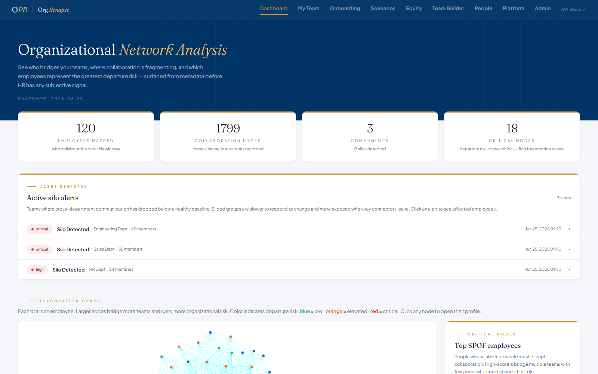
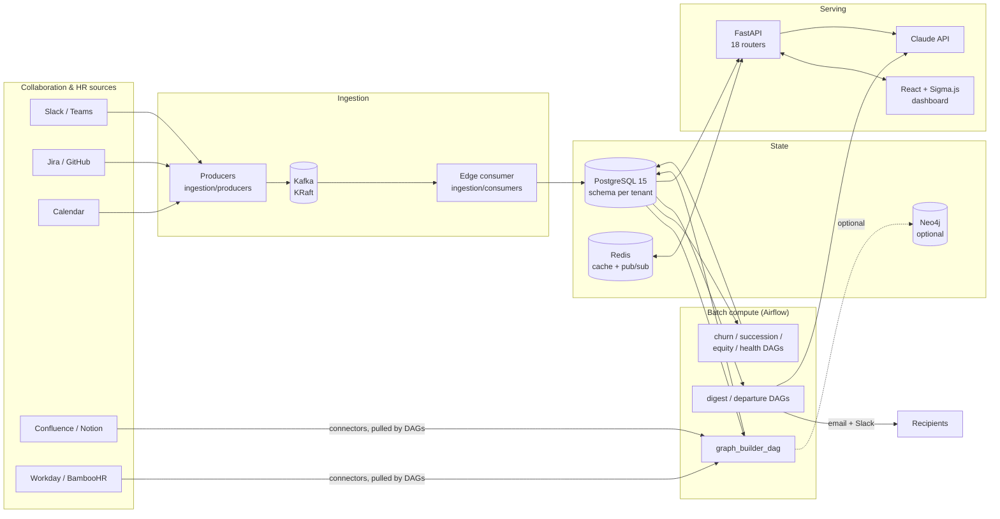
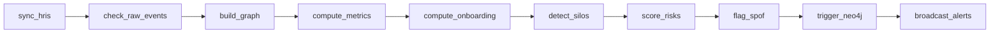
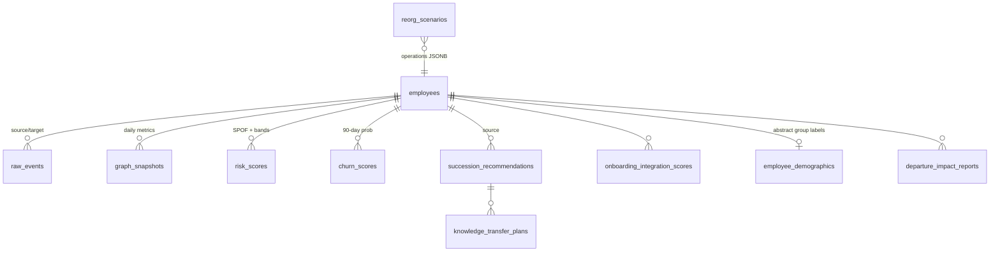
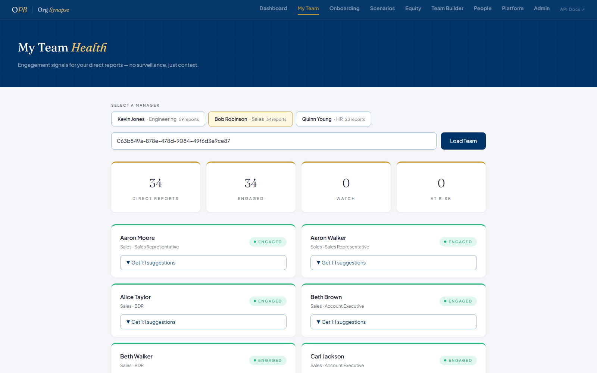
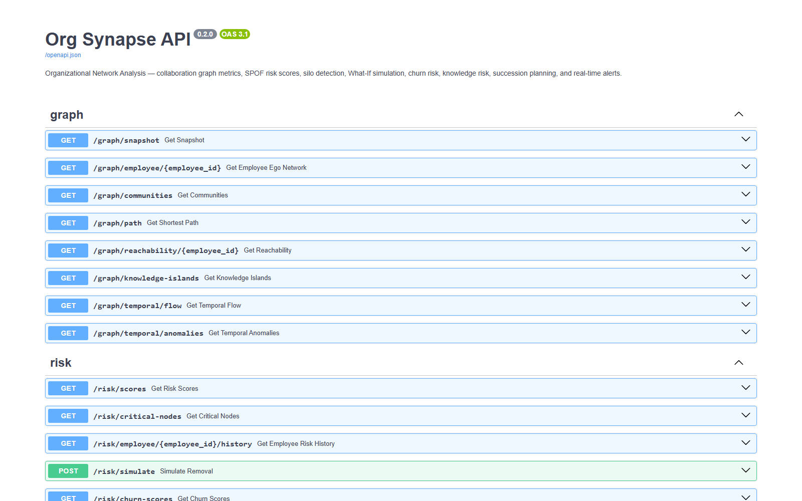

# Architecture — Organizational Synapse

This document describes how the system is put together at runtime: the components, how data moves between them, where state lives, and where the trust and privacy boundaries sit. For *why* each technology was chosen, see [Decisions.md](Decisions.md). For the formulas each pipeline computes, see [MATH_MODEL.md](MATH_MODEL.md).



---

## 1. System at a glance

Organizational Synapse is a batch-first analytics platform with a thin real-time layer. Collaboration metadata streams in continuously, and the graph and models are recomputed on a schedule. A REST API and a React dashboard serve what was computed.



| Layer | Responsibility | Code |
|---|---|---|
| Ingestion | Normalize source events to `CollaborationEvent` (metadata only) and land them in `raw_events` | [`ingestion/`](../ingestion) |
| Orchestration | Run 13 scheduled DAGs that rebuild the graph and every derived score | [`etl/dags/`](../etl/dags), [`etl/tasks/`](../etl/tasks) |
| Graph engine | Build the weighted digraph, compute centrality, communities, silos, SPOF | [`graph/`](../graph) |
| ML | Isolation Forest anomalies, ChurnGAT, temporal GConvGRU | [`ml/`](../ml), [`graph/temporal/`](../graph/temporal) |
| API | Tenant-scoped, role-gated REST + WebSocket | [`api/`](../api) |
| Dashboard | 11 pages: ONA graph, roster, manager view, scenarios, equity, and more | [`frontend/src/`](../frontend/src) |
| Observability | Prometheus scrape of `/metrics`, Grafana dashboards | [`monitoring/`](../monitoring) |

---

## 2. Data flow, end to end

### 2.1 Ingestion — metadata only

Every source is reduced to a single schema ([`ingestion/schemas/collaboration_event.py`](../ingestion/schemas/collaboration_event.py)):

```
CollaborationEvent = { event_id, source_employee_id, target_employee_id,
                       channel, direction, timestamp, weight }
```

No message bodies, subjects, file contents or attachments ever enter the system. This is enforced by the schema (it has no field to hold them), not by a policy.

- **Streaming sources** (Slack, Teams, Jira, GitHub, Calendar) publish to Kafka topic `collaboration.events.raw`, or `{tenant}.collaboration.events.raw` in multi-tenant mode. The edge consumer batches inserts into `raw_events`.
- **Pull sources** (Confluence, Notion, Workday, BambooHR) are read by DAG tasks, which write to `employees` and the knowledge tables.

### 2.2 Daily graph build

`graph_builder_dag` (02:00 UTC) is the spine. Every other DAG either waits on it through an `ExternalTaskSensor` or reads what it wrote.



1. `load_raw_edges()` selects a 30-day rolling window of `raw_events`, **joined to `employees` with `consent = true AND active = true` on both endpoints**. An employee who has not consented never gets into Python memory.
2. `build_graph()` sums weights per directed pair into a `networkx.DiGraph`, with `department` as a node attribute.
3. Metrics (betweenness, degree, clustering, Louvain community) are UPSERTed into `graph_snapshots`, keyed by `(snapshot_date, employee_id)`, so re-runs are idempotent.
4. Silo detection, SPOF scoring with robustness bands, and alerting follow.

### 2.3 Weekly model layer

| DAG | Schedule (UTC) | Depends on | Writes |
|---|---|---|---|
| `knowledge_risk_dag` | Fri 01:00 | Confluence/Notion ingest | `employee_knowledge`, `knowledge_risk_scores` |
| `anomaly_detection_dag` | Mon 03:00 | `graph_snapshots` | `alerts` (`connectivity_anomaly`) |
| `churn_risk_dag` | Sun 04:00 | features + HRIS | `churn_scores` |
| `succession_dag` | Sun 04:00 | `compute_metrics` sensor | `succession_recommendations`, `knowledge_transfer_plans` |
| `equity_dag` | Sun 04:30 | `flag_spof` sensor | `structural_equity_scores` |
| `org_health_dag` | weekly | `graph_builder_dag` | `org_health_scores` + Claude briefing |
| `weekly_digest_dag` | Sun 23:00 | `org_health_dag` | email (SendGrid) + Slack (Block Kit) |
| `departure_report_dag` | daily 06:00 | `employees.deactivated_at` | `departure_impact_reports` |
| `temporal_graph_dag` | daily 05:00 | snapshots | temporal anomaly scores |
| `neo4j_import_dag` | daily 06:00 | snapshots | Neo4j (optional mirror) |
| `compliance_dag` | quarterly | — | retention purges, audit log |

### 2.4 Serving

A dashboard request goes through these steps:

```mermaid
sequenceDiagram
    participant B as Browser (Vite :5173)
    participant A as FastAPI (:8000/8001)
    participant T as TenantMiddleware
    participant R as Redis
    participant P as PostgreSQL
    B->>A: GET /api/graph/snapshot (Vite proxy)
    A->>T: X-Tenant-ID + X-Api-Key
    T->>P: SHA-256(key) lookup in public.tenant_api_keys
    T-->>A: TenantContext(schema, role)
    A->>R: cache GET (api/cache.py)
    alt cache hit
        R-->>A: JSON
    else miss
        A->>P: SET search_path = tenant_{slug}; SELECT ...
        P-->>A: rows (RealDictCursor)
        A->>R: SETEX (TTL 3600 s)
    end
    A-->>B: JSON (role-filtered)
```

- **Role filtering happens server-side.** `require_role()` is a dependency factory. Numeric SPOF and churn scores are never serialized for `manager` or `analyst` keys, so there's nothing to hide in the UI.
- **Live alerts** use `WS /alerts/live`. Airflow `POST`s to `/internal/alerts/broadcast`, which publishes to Redis pub/sub, so every API worker fans the alert out to its own WebSocket clients.
- **Natural-language queries** (`POST /query/natural`) use Claude with tool use. The model calls the query tools defined in [`api/nl/tools.py`](../api/nl/tools.py) rather than writing free-form SQL.

---

## 3. State and storage



| Store | Holds | Retention | Notes |
|---|---|---|---|
| PostgreSQL `tenant_{slug}.*` | All per-tenant facts and scores | `raw_events` 90 d, `graph_snapshots` 365 d | 18 ordered migrations in [`data/migrations/`](../data/migrations) |
| PostgreSQL `public.*` | `tenants`, `tenant_api_keys(role, sha256)`, `tenant_usage` | — | Shared control plane |
| Redis | API response cache (TTL 1 h), alert pub/sub | volatile | Exposed on host port 6380 |
| Neo4j | Optional mirror for Cypher / GDS exploration | daily rebuild | Not on the critical path |
| Browser `localStorage` | Transfer-plan checklist ticks | per device | Deliberately not persisted server-side ([Decisions §21](Decisions.md)) |

PostgreSQL is the only system of record. Neo4j and Redis can be dropped and rebuilt from it.

---

## 4. Multi-tenancy and access control

- **Provisioning:** a tenant schema is built by running `data/migrations/` inside it (`api.tenant.apply_tenant_migrations`), so it always matches the default schema. `scripts/migrate_tenants.py` brings existing tenants up to date.
- **Isolation:** each tenant gets its own schema. `TenantMiddleware` resolves `X-Tenant-ID` + `X-Api-Key` to a schema and sets `search_path` for that request's connection. No query carries a `tenant_id` predicate that someone could forget to add.
- **Credentials:** API keys are stored only as SHA-256 hashes, and the raw key is shown once at provisioning.
- **Roles:** stored on the key, not the employee, so one person can hold an `hr_admin` key and a `manager` key.

| Role | Sees |
|---|---|
| `hr_admin` | Everything: names, scores, churn probabilities, transfer plans |
| `executive` | Department aggregates only |
| `analyst` | Anonymised topology, with no names and no scores |
| `manager` | Own direct reports, as a traffic light plus AI 1:1 prompts |



---

## 5. Privacy boundaries (by construction)

| Boundary | Mechanism | Where |
|---|---|---|
| No content | Event schema has no content field | `ingestion/schemas` |
| Consent | SQL `JOIN ... consent = true` before graph build | `graph/builder.py` |
| DEI aggregates only | Group labels are abstract IDs; API returns medians/IQR per group, never per person; groups under `EQUITY_MIN_GROUP_SIZE` (5) are suppressed in SQL and again in the router | `etl/tasks/compute_equity.py`, `api/routers/equity.py` |
| Manager abstraction | Scores dropped from the response model for `manager` role | `api/routers/manager.py` |
| Right to portability | `GET /compliance/data-export/{id}` (GDPR Art. 20) | `graph/compliance.py` |
| Retention | Quarterly purge DAG + audit log | `compliance_dag` |

The full threat model is in [DPIA_THREAT_MODEL.md](DPIA_THREAT_MODEL.md).

---

## 6. Runtime topology (local / demo)

`docker-compose.yml` runs the infrastructure. The API and Vite run on the host so they hot-reload.

| Service | Host port | In compose | Required for dashboard |
|---|---|---|---|
| PostgreSQL 15 | 5433 | yes | **yes** |
| Redis 7 | 6380 | yes | recommended (API degrades to uncached) |
| Kafka 3.7 (KRaft) | 9092 | yes | no (only for live ingestion) |
| Airflow web / scheduler | 8088 | yes | no (only for recompute) |
| Neo4j 5 | 7474 / 7687 | yes | no |
| Prometheus / Grafana | 9090 / 3000 | yes | no |
| Adminer | 8081 | yes | no |
| FastAPI | 8000 (8001 on Windows dev) | host | **yes** |
| Vite dashboard | 5173 | host | **yes** |

The minimum set to view a seeded dashboard is **Postgres + API + Vite**. That's how the screenshots in these docs were captured.

### Graceful degradation

Several dependencies are soft imports, so the core keeps working when they're missing:

| Missing | Behavior |
|---|---|
| `torch_geometric` | ChurnGAT unavailable; validation uses a GraphSAGE-style MLP surrogate; baseline LogReg is the recommended production model |
| `torch_geometric_temporal` | Temporal GNN tests skip; daily snapshots still computed |
| `python-louvain` | Falls back to NetworkX Louvain, then connected components |
| `prometheus_fastapi_instrumentator` | `/metrics` disabled; `/health` reports `metrics: disabled` |
| Neo4j | `neo4j_import_dag` no-ops; nothing else reads it |
| `ANTHROPIC_API_KEY` | Org-health briefing falls back to a deterministic template; LLM-only features (NL query, 1:1 suggestions) are unavailable |

---

## 7. Scaling envelope

| Concern | Current approach | Ceiling / next step |
|---|---|---|
| Betweenness O(n·m) | Exact below 500 nodes; Brandes k-pivot (k=200, seed 42) above, error ~O(1/√k) | Designed for a 30 s DAG budget; for very large orgs, offload to Neo4j GDS. See `tests/performance/load_test.py` |
| Louvain variance | Parallel trials via joblib above 500 nodes; best modularity wins | Deterministic Leiden would stabilize community IDs |
| Batch latency | Daily graph, weekly models | Roadmap: Kafka consumer writes graph deltas for high-frequency channels |
| Executor | Airflow LocalExecutor | Celery/Kubernetes executor once there's more than one tenant per box |
| API | Stateless workers + Redis pub/sub fan-out | Horizontal behind a load balancer as-is |

---

## 8. Interface surface

The API is self-documenting at `/docs`. The README's [API reference](../README.md#api-reference) groups the endpoints by purpose.



---

*OPB · Octavio Pérez Bravo · Data & AI Strategy Architect*
