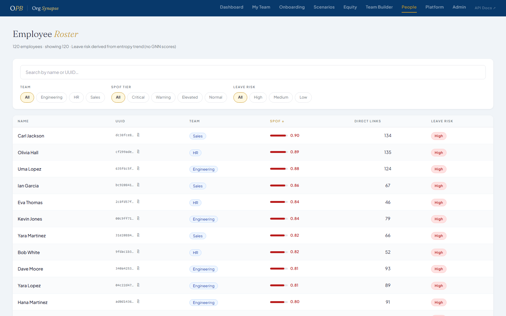
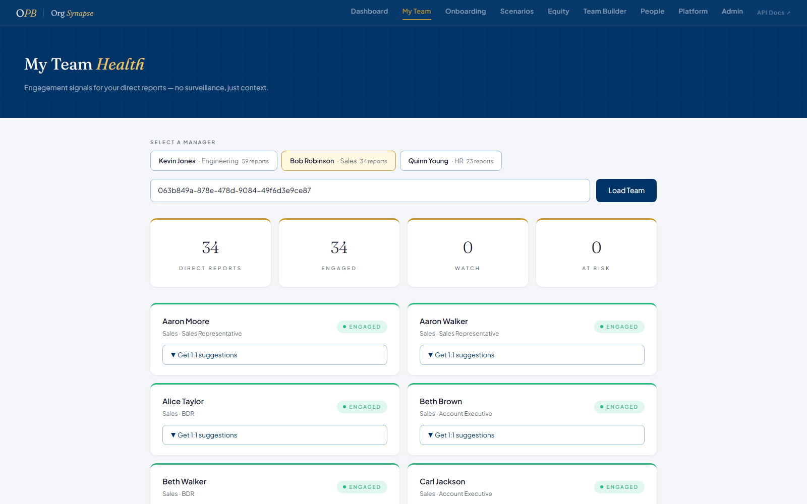

# Business Value — Organizational Synapse

What the platform is worth to the organization that runs it: which decisions it changes, how to estimate the value of those changes, and how to prove the value after the fact.

The market, pricing and go-to-market case is in [Business.md](Business.md). The buyer-facing narrative is in [PITCH.md](PITCH.md). This document is the **value model**.

---

## 1. The one-sentence value proposition

> Synapse finds the people your organization structurally depends on, and the moments those dependencies start to break, early enough to act on them, using collaboration metadata the company already generates.

The value doesn't come from the dashboards. It comes from **decisions made earlier, or made differently**, because the signal was visible.

---

## 2. Decisions it changes

| Decision | Without Synapse | With Synapse | Where in the product |
|---|---|---|---|
| Who to retain first | Seniority, title, manager intuition | Ranked structural dependency (SPOF), robust under weight perturbation | Dashboard · People roster |
| When to intervene | Resignation letter / exit interview | Entropy trend turns negative weeks before departure; peer-contagion flag | Employee detail · Alerts |
| Who succeeds a critical person | 9-box, leadership potential | Structural compatibility: shared network, domain overlap, embeddedness | Succession · Transfer plan |
| What a reorg will break | Org-chart redraw, post-hoc surprises | Simulated Δ path length, new isolated clusters, SPOF shifts before announcing | Scenario planner |
| Who to staff on a cross-functional initiative | Availability, who-you-know | Greedy set-cover over departments × domains, avoiding overloaded people | Team builder |
| Whether a new hire is integrating | 90-day review | Cohort-relative integration score with a day-60 alert | Onboarding tracker |
| Where structural inequity may exist | Representation counts | Centrality distribution by group, with an investigation trigger | Equity dashboard |



---

## 3. Value levers

Each lever below has a mechanism, an input you can measure, and a formula. Every number in the worked example (§4) is an **assumption to replace with your own data**, not a product claim.

### Lever A: Avoided regrettable departures of structurally critical people

**Mechanism:** a robust-critical employee showing a withdrawal trend is flagged early enough for a retention conversation, a role change, or a compensation review.

```
Value_A = N_critical × p_leave × uplift_retained × C_replace_critical
```

| Input | Meaning | Source |
|---|---|---|
| N_critical | Employees flagged `critical` (robust) | Dashboard KPI |
| p_leave | Annual voluntary exit rate for that group | HRIS history |
| uplift_retained | Share of those exits an early intervention prevents | Your own pilot (start conservatively) |
| C_replace_critical | Replacement cost for a structural hub | SHRM's 50–200 % of salary, plus a network-rebuild premium |

### Lever B: Shorter knowledge-loss recovery when a departure does happen

**Mechanism:** succession candidates and a 90-day transfer plan exist *before* the exit, so the gap closes faster.

```
Value_B = N_departures_critical × Δmonths_recovery × monthly_productivity_loss
```

The departure impact report measures the actual structural damage at t+30 and t+60. That gives you Δmonths from your own data after the first few departures.

### Lever C: Avoided reorg damage

**Mechanism:** the scenario planner exposes moves that fragment the network or overload one bridge, before they're announced.

```
Value_C = P(harmful design caught) × cost_of_reorg_rework
```

### Lever D: Faster new-hire integration

**Mechanism:** a day-60 alert on below-cohort integration triggers a buddy, cross-team introductions, or a manager check-in.

```
Value_D = N_new_hires × p_below_cohort × Δdays_to_productivity × daily_loaded_cost × response_rate
```

### Lever E: Analyst and HRBP time

**Mechanism:** the weekly digest and NL query replace manual ONA surveys and ad-hoc reporting.

```
Value_E = hours_saved_per_week × 52 × loaded_hourly_rate
```

---

## 4. Worked example (illustrative)

This uses the demo organization shown in the screenshots: **120 employees, 1,799 collaboration edges, 18 critical nodes**. All monetary inputs are placeholders.

| Lever | Assumptions | Annual value |
|---|---|---|
| A · Retention | 18 critical × 15 % exit rate × 25 % prevented × $150k replacement | **≈ $101k** |
| B · Recovery | 2 critical exits/yr × 3 months faster × $12k/month productivity gap | **≈ $72k** |
| C · Reorg | 1 reorg/yr × 30 % chance a harmful move is caught × $80k rework | **≈ $24k** |
| D · Onboarding | 20 hires × 25 % below cohort × 15 days faster × $500/day × 50 % response | **≈ $19k** |
| E · Time | 4 h/week × 52 × $90/h | **≈ $19k** |
| **Total** | | **≈ $235k / year** |

How to read it:

- **Lever A dominates.** That holds in general: value scales with how concentrated structural risk is, not with headcount alone. A 120-person company with 18 hubs has more at stake per head than a 1,000-person company with a flat network.
- **The model is linear in `uplift_retained`.** That input is the least known, so run the pilot (§6) before quoting it.
- For a go/no-go, compare a **deliberately pessimistic** version (for example, halve `uplift_retained` and drop Lever C) against the subscription tier for your size ([Business.md §6](Business.md#6-revenue-model)) plus internal run cost.

---

## 5. Value by stakeholder

| Stakeholder | What they get | Screen |
|---|---|---|
| **CHRO / CPO** | Weekly 0–100 org-health score with an AI briefing; board-ready structural risk view | Org health card · Weekly digest |
| **HRBP / People Analytics** | Ranked SPOF list with robustness flags, succession candidates, transfer plans, equity triggers | Dashboard · Employee detail · Equity |
| **Line manager** | Traffic light per direct report plus suggested 1:1 prompts. No raw scores, no surveillance framing | My Team |
| **Org design / Finance** | What-if impact of removals, merges and team moves | Scenario planner |
| **Program / Eng leadership** | Teams that bridge required departments and domains without overloading hubs | Team builder |
| **DPO / Legal** | Metadata-only design, consent gating, GDPR Art. 20 export, DPIA | Compliance endpoints · [DPIA](DPIA_THREAT_MODEL.md) |



---

## 6. Proving it: a 90-day value pilot

| Phase | Weeks | Activity | Exit criterion |
|---|---|---|---|
| **Baseline** | 0–2 | Connect 2–3 channels + HRIS; first graph and SPOF run; HRBP reviews the top-20 list | HRBPs agree ≥ 70 % of top-20 are "people we'd worry about losing" (face validity) |
| **Shadow** | 3–8 | Scores computed weekly; no interventions; record departures and reorg events | Every departure gets an impact report; SPOF rank recorded *before* the event |
| **Act** | 9–12 | Interventions for robust-critical + withdrawing employees; transfer plans for the top 5 | Intervention log kept; at least one scenario run before a real org change |
| **Readout** | 13 | Compare flagged vs. unflagged exit rates; time-to-recover from impact reports; analyst hours saved | Replace every assumption in §4 with a measured value |

**KPIs to track from day one**

| KPI | Definition | Lever |
|---|---|---|
| Critical-exit rate | Exits among robust-critical ÷ robust-critical headcount | A |
| Lead time | Days between first withdrawal flag and resignation | A |
| Structural recovery time | Days until the departed person's neighbourhood betweenness returns to baseline | B |
| Succession coverage | % of robust-critical employees with ≥ 1 candidate and an active transfer plan | B |
| Scenario usage | Reorg decisions preceded by a simulation | C |
| Day-60 integration gap | Share of new hires below cohort p25 at day 60 | D |
| Org health trend | Weekly score and tier changes | All |

---

## 7. What it is not, and why that protects the value

| Boundary | Why it matters for value |
|---|---|
| **Not performance management.** SPOF measures dependency, not contribution | Using it for ratings would destroy trust and the honesty of the collaboration signal |
| **Not individual surveillance.** No content is ingested; managers see traffic lights only | Employee trust keeps consent rates high, and the graph is only as good as consent coverage |
| **Not a hiring or firing decision engine.** `critical_uncertain` and equity flags explicitly require human review | Keeps the platform outside the riskiest automated-decision use cases under GDPR Art. 22 and the EU AI Act |
| **Not yet empirically calibrated on real departures.** Validation is on synthetic ground truth | §6 is how each customer generates the calibration data. Until then, treat scores as structured hypotheses |

---

## 8. Where value compounds

1. **Departure impact reports turn into training labels.** Each real exit, with its pre-event SPOF and churn scores, is a labeled example. After roughly 500 labeled employees across three or more cohorts, the graph churn model is expected to beat the tabular baseline ([MODEL_CARD_CHURN.md](MODEL_CARD_CHURN.md)).
2. **Intervention tracking closes the loop.** Recording whether a transfer plan was executed and whether SPOF moved turns the platform from predictive into prescriptive evidence (Roadmap, long-term).
3. **Benchmarks.** Anonymised cross-tenant percentiles make "health 72" interpretable against peers (Roadmap).

---

*OPB · Octavio Pérez Bravo · Data & AI Strategy Architect*
