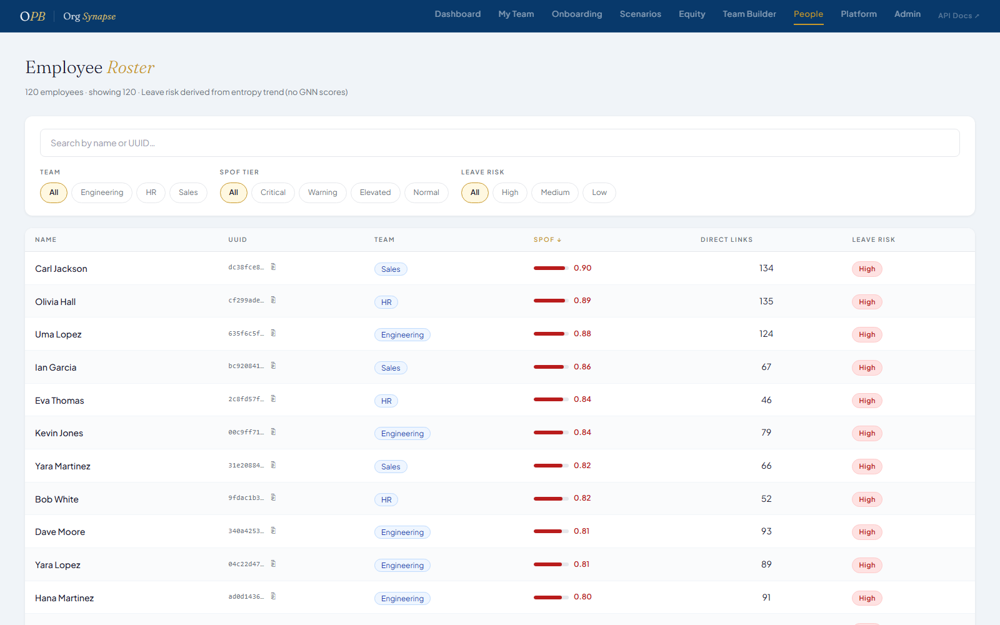

# Engineering — Organizational Synapse

How the codebase is organized, the conventions it follows, how it's tested and shipped, and how to extend it without breaking what's there. The per-technology rationale lives in [Decisions.md](Decisions.md), and the runtime picture in [ARCHITECTURE.md](ARCHITECTURE.md).

---

## 1. Codebase map

| Package | What lives here | Size |
|---|---|---|
| `ingestion/` | Pydantic `CollaborationEvent`, Kafka producers (synthetic + real API), edge consumer, Confluence/Notion/HRIS connectors | — |
| `graph/` | Graph build, metrics, SPOF, silos, succession, scenarios, team optimizer, org health, compliance, Neo4j client, temporal GNN | ~4,000 LOC |
| `ml/` | Isolation Forest, feature extraction, ChurnGAT (model, trainer, scorer) | ~1,250 LOC |
| `etl/` | 13 Airflow DAGs + plain-Python task callables | — |
| `api/` | FastAPI app, 18 routers, tenant middleware, cache, NL tool layer | — |
| `frontend/` | React 18 + Vite 5, 11 pages, Sigma.js graph, Recharts, TanStack Query | — |
| `data/migrations/` | 18 ordered SQL migrations (`000` → `017`) | — |
| `tests/` | `unit/` (21 files), `validation/` (4 ground-truth suites), `integration/`, `performance/` | — |

---

## 2. Conventions that hold the code together

### 2.1 Pure core, thin I/O shell

Every scoring module is split into **pure functions** (dicts and graphs in, dicts out, no DB) and **DB-backed wrappers** (`load_*`, `compute_and_persist`, `write_*`). The module docstring lists which is which, for example in [`graph/knowledge_risk.py`](../graph/knowledge_risk.py):

```
Pure functions (testable without DB):
    compute_knowledge_scores_from_contributions(contributions)
    compute_sole_experts(contributions)
DB-backed functions:
    load_contributions(conn)
    compute_and_persist(snapshot_date, conn)
```

This is what lets the 30-test validation suite run in about 12 s with no Postgres or Kafka. It also explains the coverage shape: the pure math is well covered and the `compute_and_persist` paths are not (see §4.3).

### 2.2 Airflow DAGs only wire, tasks compute

DAG files in `etl/dags/` contain scheduling, sensors, and `PythonOperator` wiring. The work happens in `etl/tasks/*.py`, which import nothing from Airflow. That means:

- tasks can be called from `scripts/seed_dev.py` and from tests directly;
- Airflow runs only in Docker and is **not** in `requirements.txt` ([Decisions §5](Decisions.md)).

### 2.3 Every weight is an environment variable

All formula weights, thresholds and windows are read with `os.environ.get(NAME, default)` at import time (`SPOF_ALPHA`, `HEALTH_W_FRAG`, `FRAGMENTATION_LAMBDA`, `IF_CONTAMINATION`, …). Tuning never needs a deploy. The full list is in [MODEL.md §14](MODEL.md#14-parameter-reference-updated-v2).

> **Caveat:** an env var only works if the code actually reads it. `CHANNEL_WEIGHT_*` and `KNOWLEDGE_LAMBDA` were documented but unread until November 2026. [MATH_MODEL.md §12](MATH_MODEL.md#12-spec-vs-implementation) is the ledger of remaining spec/code differences, and `.env.example` marks retired variables (`SILO_THRESHOLD`, `SILO_THRESHOLD_RATIO`, `SPOF_PERTURB_RANGE`, `HEALTH_ENTROPY_SCALE`).

### 2.4 Idempotent writes

Snapshot and score tables are written with `INSERT … ON CONFLICT … DO UPDATE` keyed by `(date, employee_id)`, so a DAG re-run for the same date overwrites rather than duplicates. Alert writers check for an existing alert on the date before inserting.

The exception is `scripts/seed_dev.py`, which inserts employees without deduplication. A failed seed that you re-run will double the org. Truncate first (see §6).

### 2.5 Soft dependencies

Heavy or optional libraries are imported in `try/except ImportError` blocks that set a flag (`_PYG_AVAILABLE`, `_LOUVAIN_AVAILABLE`, `_PROMETHEUS_AVAILABLE`, `_TGNN_AVAILABLE`), and the code branches on that flag. The core platform runs without PyTorch Geometric, Neo4j, or Prometheus.

### 2.6 Raw SQL, no ORM

The API uses `psycopg2` with `RealDictCursor`. Queries are parameterized (`%s`) throughout. The one f-string SQL pattern, in `compute_equity.py`, interpolates only a whitelisted dimension column name. `graph/builder.py` accepts both tuple rows and `RealDictRow`s, because unpacking a dict row yields its keys and once silently turned a weight into the string `'weight'`.

### 2.7 RBAC as a dependency, not middleware

`TenantMiddleware` resolves *who* the caller is. `require_role("hr_admin", …)` is a FastAPI dependency factory that decides *what* they may call. Response models for restricted roles omit score fields entirely, so nothing sensitive is serialized.

---

## 3. Local development

### 3.1 One command

```powershell
.\demo.ps1          # Windows: clears ports, loads .env, starts compose, opens API + Vite windows
python scripts/seed_dev.py --employees 120 --days 60
```

### 3.2 Minimum stack for frontend work

You don't need Kafka, Airflow, or Neo4j to work on the dashboard:

```powershell
docker compose -p org-synapse up -d postgres redis
# load .env into the shell (api/deps.py reads os.environ; there is no load_dotenv)
Get-Content .env | % { if ($_ -match '^\s*([^#][^=]+)=(.*)$') { [Environment]::SetEnvironmentVariable($Matches[1].Trim(), $Matches[2].Trim()) } }
$env:PYTHONPATH = (Get-Location).Path
python -m uvicorn api.main:app --host 127.0.0.1 --port 8001
cd frontend; npm run dev          # Vite proxies /api → http://localhost:8001
```

### 3.3 Known environment traps

| Symptom | Cause | Fix |
|---|---|---|
| Every endpoint 500s with `'_IncludedRouter' object has no attribute 'path'` | An old `prometheus-fastapi-instrumentator` (7.x) left in the environment; it breaks on recent FastAPI router internals | `pip install -r requirements.txt` (now requires `>=8.1.0,<9`). `tests/unit/test_app_smoke.py` catches a regression |
| Two cache tests fail locally (`test_cache_disabled_by_env`, `test_graph_snapshot_404_when_no_data`) | Another Redis is listening on `localhost:6379` and the tests pick up real cached values | Run with `REDIS_URL=redis://localhost:1/0` |
| `WSAEADDRINUSE` on :8000 | Windows leaves orphaned LISTEN sockets after a crashed uvicorn | Use :8001 (already the Vite proxy target) |
| Endpoints 500 with a connection error to :5432 | `.env` not loaded into the shell | Load `.env` (above) or use `demo.ps1` |
| Dashboard empty but API healthy | `frontend/.env` vs repo-root `.env` confusion | Vite reads `frontend/.env`; the proxy target is in `vite.config.js` |
| Seed fails at SPOF step: `column "spof_score_lo" does not exist` | Migration 017 not applied | Apply `017_model_v2_v3_corrections.sql` |
| Employee count doubles (120 → 240) | Seed re-run after a partial failure | `TRUNCATE employees, raw_events, … CASCADE` and re-seed |

---

## 4. Quality gates

### 4.1 Lint and format: Ruff

Configured in [`pyproject.toml`](../pyproject.toml): `py311`, line length 120, rule sets **E, F, W, B, UP**. Each ignored rule carries its reason inline. For example, `B008` is ignored for FastAPI's `Depends()` defaults and `E402` for the `sys.path.insert` pattern in runnable scripts. The [Ruff workflow](../.github/workflows/ruff.yml) runs `ruff check` and `ruff format --check` on `graph/ ml/ ingestion/ api/ etl/ tests/` with Ruff pinned to `0.9.10`, and prints the diff when the format check fails.

### 4.2 Types: mypy

The CI scope is `graph/`, `ml/anomaly/`, and `ml/features/`, with `--ignore-missing-imports --no-strict-optional`. Two areas are excluded and tracked:

- `graph/org_health.py`: Anthropic SDK content-block union narrowing;
- `graph/temporal/`: torch `Tensor` vs `float` annotation gaps.

### 4.3 Tests

| Suite | What it proves | Needs | Runtime |
|---|---|---|---|
| `tests/validation/` (synthetic) | Models recover **planted ground truth**: bridges, withdrawers, sole experts, silos, anomalies, entropy-trend accuracy, sudden-withdrawal false alarms and power, churn calibration, peer-departure, equity and conformal-anomaly nulls (51 tests) | nothing | < 1 min |
| `tests/validation/real_network_evaluator.py` | The same models on a **real** e-mail network: real-data nulls (shuffled labels or weeks) and injected withdrawals (8 tests) | `python scripts/fetch_external_data.py` (skips otherwise) | ~15 s |
| `tests/unit/` | Pure functions + API routers with `dependency_overrides` mocking the DB (~497 tests) | nothing | fast |
| `tests/integration/` | DAG import/wiring; Kafka → consumer → Postgres | Docker Compose | `-m integration` |
| `tests/performance/` | Load test of the API | running API | manual |

`pytest.ini` collects `test_*.py`, `*_validator.py` and `*_evaluator.py`, which is why the validation files don't need a `test_` prefix.

**CI** ([`ci.yml`](../.github/workflows/ci.yml)) runs the unit and validation suites on Python **3.11 and 3.12**. It installs CPU-only torch first to avoid the 2 GB CUDA wheel, and uploads coverage to Codecov from the 3.11 leg without ever failing the build on an upload error.

Two files are excluded from CI because of known mock-fixture gaps: `test_tenant.py` (fixture missing the `role` field added to `TenantContext`) and `test_compliance.py` (same gap on the admin-key path). Fixing those fixtures is the cheapest coverage win in the repo.

### 4.4 Coverage, honestly

The README reports ~35 % overall. The math modules are well covered: `compliance.py` 100 %, `neo4j_client.py` 90 %, and `risk_scorer.py` and `org_health.py` in the 60s. The gap sits in DB write paths and ingestion connectors, which is exactly what §2.1's split predicts. Integration tests against a real Postgres are the way to close it, not more mocks.

---

## 5. Data model changes

1. Add the next numbered file in `data/migrations/` (for example `018_*.sql`). Never edit a migration that has already been applied.
2. Make it idempotent (`ADD COLUMN IF NOT EXISTS`, `CREATE TABLE IF NOT EXISTS`), because `demo.ps1` and the README loop re-apply the whole directory.
3. Multi-tenant deployments need nothing extra for **new** tenants: `apply_tenant_migrations()` in [`api/tenant.py`](../api/tenant.py) builds each tenant schema from `data/migrations/` with `search_path` set to the tenant schema only. Write migrations with unqualified names, and put shared control-plane objects in a file listed in `_CONTROL_PLANE_MIGRATIONS`. For **existing** tenants, run `python scripts/migrate_tenants.py` (or `--dry-run` first).
4. If the new column feeds a score, add it to the pure function first, then to `compute_and_persist`, and only then to the API response model.

---

## 6. Recipe: adding a new score

The pattern every existing score follows:

1. **Math first.** Write the formula and its weights in [MATH_MODEL.md](MATH_MODEL.md), with the theory in [MODEL.md](MODEL.md).
2. **Pure function** in `graph/` or `ml/`, with weights from env vars and defaults in code.
3. **Validation test** in `tests/validation/`: plant an archetype the score should catch and one it should not, and assert both.
4. **Unit tests** for edge cases: empty graph, single node, all-zero inputs.
5. **Task callable** in `etl/tasks/`, and wire it into the appropriate DAG after its upstream sensor.
6. **Migration** for the result table, with an UPSERT key on `(scored_date, employee_id)`.
7. **Router** in `api/routers/`, guarded by `require_role(...)`, and register it in `api/main.py`.
8. **Seed step** in `scripts/seed_dev.py` so the demo shows it.
9. **UI** in `frontend/src/pages/`, reading the endpoint through TanStack Query.

---

## 7. Release checklist

- [ ] `python -m ruff check . && python -m ruff format --check .`
- [ ] `python -m mypy graph ml/anomaly ml/features --ignore-missing-imports --no-strict-optional`
- [ ] `pytest tests/unit tests/validation -m "not integration"` is green on 3.11 and 3.12
- [ ] Validation numbers in the README still match the suite output
- [ ] New env vars are documented in MODEL.md §14 **and actually read in code**
- [ ] Migration applied cleanly to a fresh DB *and* to a seeded one
- [ ] Screenshots in `docs/screenshots/` refreshed if the UI changed



---

*OPB · Octavio Pérez Bravo · Data & AI Strategy Architect*
