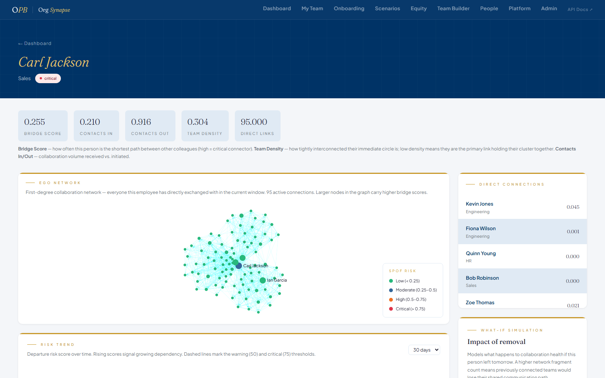
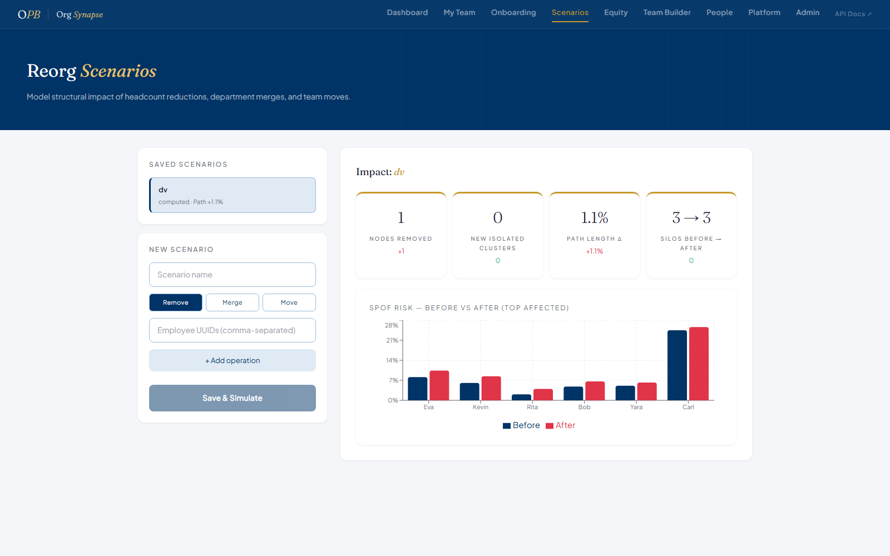

# Math Model — Organizational Synapse

A single reference for every quantity the platform computes, **written from the code as it runs today**. Each formula links to its implementation.

[MODEL.md](MODEL.md) is the companion research document. It holds the theoretical justification, the literature, and the v2/v3 change history. Several of its sections still read "unchanged from original" and point at a v1 that is no longer in the repo; this document fills those gaps from the source. Where the code and MODEL.md disagree, §12 lists the difference so it can be fixed rather than hidden.

---

## Contents

1. [Notation](#1-notation)
2. [Graph construction](#2-graph-construction)
3. [Node metrics](#3-node-metrics)
4. [Interaction entropy and trend](#4-interaction-entropy-and-trend)
5. [SPOF score](#5-spof-score)
6. [Knowledge risk and enhanced SPOF](#6-knowledge-risk-and-enhanced-spof)
7. [Silo detection](#7-silo-detection)
8. [Anomaly detection](#8-anomaly-detection-isolation-forest)
9. [Churn models](#9-churn-models)
10. [Prescriptive models](#10-prescriptive-models)
11. [Org health score](#11-org-health-score)
12. [Spec vs. implementation](#12-spec-vs-implementation)
13. [How the models are validated](#13-how-the-models-are-validated)

---

## 1. Notation

| Symbol | Meaning |
|---|---|
| G = (V, E) | Directed weighted collaboration graph over a rolling window W (default 30 days) |
| w(u,v) | Sum of event weights from u to v inside W |
| N(v) | Undirected neighbourhood: predecessors ∪ successors of v |
| dept(v) | Department attribute on node v |
| R(x, V) | Percent rank of x in population V: `#{y ∈ V : y < x} / (|V| − 1)` |
| clip(x, a, b) | min(max(x, a), b) |

---

## 2. Graph construction

**Code:** [`graph/builder.py`](../graph/builder.py), [`graph/edge_weights.py`](../graph/edge_weights.py)

```
Events e = (s, t, channel, direction, ts, weight)   with ts ∈ [T − W, T]
          and consent(s) ∧ consent(t) ∧ active(s) ∧ active(t)

w(s, t) = Σ_e weight(e) · ω_c(channel(e)) · ω_d(direction(e))
```

| Channel | ω_c | | Direction | ω_d |
|---|---|---|---|---|
| github | 3.0 | | reviewed | 1.5 |
| calendar | 2.5 | | assigned | 1.2 |
| jira | 1.5 | | invited | 1.0 |
| email / slack / teams | 1.0 | | mentioned | 0.8 |
| | | | sent | 0.7 |

A GitHub review is therefore worth 4.5 Slack-message-equivalents per event, and a Slack message 0.7. The rationale is in MODEL.md §2.2 (media richness, tacit-knowledge depth). For remote-heavy orgs, consider lowering `CHANNEL_WEIGHT_CALENDAR` to 1.8–2.0 (§2.2.7).

- The graph is **directed**. A→B and B→A are separate edges, which keeps asymmetry (who initiates and who receives).
- Every loader that turns `raw_events` into edges (graph build, scenarios, succession, NL tools, the dashboard edge endpoints) uses the same `weighted_edge_sql()`, so all metrics see one graph. `CHANNEL_WEIGHTING=off` reverts to raw counts for A/B comparison.
- The consent and active filters run **in SQL**, so excluded employees never become nodes.
- **Exception:** the ChurnGAT and temporal GNN use `log1p(event count)` edge weights. Their trained checkpoints depend on that, so they are unchanged until the next retrain.

---

## 3. Node metrics

**Code:** [`graph/metrics.py`](../graph/metrics.py)

| Metric | Definition | Implementation detail |
|---|---|---|
| **Betweenness** BC(v) | Σ_{s≠v≠t} σ(s,t\|v) / σ(s,t), normalized | Computed on the **directed** graph with path cost `1 / max(w, 1e-9)`, so frequent collaborators are "closer". Exact for n ≤ 500; above that, Brandes k-pivot sampling with k = 200 and `seed = 42` (error ≈ O(1/√k)). Undirected is the documented intent, but it is not yet adopted; see the note below |
| **Degree** d_in, d_out | in/out degree ÷ (n − 1) | NetworkX degree centrality |
| **Clustering** CC(v) | Triangles through v ÷ possible triangles | On the **undirected** projection |
| **Community** | Louvain, max modularity | `random_state = 42`; for n > 500, up to 8 parallel trials and the best modularity wins |
| **Cross-department ratio** CDR(v) | `|{(v,u) ∈ E_out : dept(u) ≠ dept(v)}| / |E_out(v)|` | Counts out-edges (not weights); 0 if v has no out-edges |

> **Why betweenness is still directed.** [Decisions.md §6](Decisions.md) argues for undirected betweenness: knowledge flows A→B→C through B whoever initiated each tie. Switching to undirected (with tie strength w(u,v) + w(v,u)) was implemented and tested. It cut validation **Precision@critical from 100 % to 50 %**, because three NORMAL employees crossed 0.70.
>
> The cause is the rank-percentile step in §5. Directed betweenness is exactly 0 for most people, so they tie at percentile 0. Undirected betweenness is tiny but nonzero for almost everyone, and ranking stretches those negligible differences across the full 0–1 range, so low-activity people with one cross-department tie rank as top brokers.
>
> Undirected betweenness should be revisited together with a tail-aware normalization of the BC term (track B/D), not on its own.

---

## 4. Interaction entropy and trend

**Code:** [`ml/features/feature_extractor.py`](../ml/features/feature_extractor.py)

The 28 days ending on the snapshot date are split into 4 equal 7-day weeks, k = 0…3 (oldest first), counted back from the snapshot. Only events between consenting, active employees count. For each employee and week:

```
p_k(v, u) = count_k(v → u) / Σ_x count_k(v → x)

H_k(v) = − Σ_u p_k(v,u) · log₂ p_k(v,u)        (bits; 0 if no activity)
```

H measures how *spread* someone's collaboration is. A falling trend means the person is interacting with fewer distinct people, which is the **withdrawal** signal. It is the earliest-moving input in the system and also the noisiest one, which is why it carries the smallest weight in SPOF.

### 4.1 Robust, shrunk trend

A straight-line fit through 4 noisy points has two failure modes: one odd week (holiday, offsite) swings it, and people with only a few events a week dominate both tails. The trend is therefore estimated in three steps:

```
1. raw slope      s_v  = median over pairs i<j of (H_j − H_i)/(j − i)              Theil-Sen, 6 pairs
2. its noise      v_v  = Σ_k w_k² · Var(H_k) / (Σ_k w_k²)²,   w_k = k − 1.5
                  Var(H_k) = max( (Σ p·log₂²p − H²)/n_k , 1/n_k )                  delta method, floored; empty week = 1
3. shrinkage      τ²   = DerSimonian–Laird between-employee variance of s given v
                  B_v  = τ² / (τ² + v_v)
                  entropy_trend(v) = m + B_v (s_v − m),   m = median_v s_v
                  sd_v = √(B_v · v_v)

withdrawing(v)  ⇔  P(true slope < −0.05) = Φ((−0.05 − entropy_trend) / sd) ≥ 0.90
```

- **Theil-Sen** fully ignores an outlier in a middle week. An outlier in the *latest* week moves it about halfway, because with 4 points a collapse in the newest week looks the same as the start of real withdrawal. Change-point detection on daily activity (§4.2) adjudicates that case.
- **Shrinkage** pulls an employee toward the population center in proportion to how noisy their estimate is. On the validation org, a low-activity employee keeps a median 23 % of their raw slope and a well-measured one keeps 64 %.
- **DerSimonian–Laird** is the standard random-effects estimator for units with heterogeneous known variances. The simpler method of moments, Var(s) − mean(v), was tried first and failed: variances differ by orders of magnitude, so a few near-silent employees inflate mean(v), and τ² collapsed to ≈0, shrinking everyone onto the median.
- **The variance formula** over-states true sampling variance by about 1.5–3× in isolation. It was nevertheless the best of four variants inside the full pipeline: looser floors raised false positives to 7–10 %, and the second-order Basharin term breaks on single-partner weeks.
- **The withdrawing flag is probabilistic.** It no longer means "noisy estimate below −0.05", and the threshold (`ENTROPY_SLOPE_THRESHOLD`) and confidence (`ENTROPY_WITHDRAW_CONFIDENCE`) are configurable.

Measured on planted ground truth ([`tests/validation/entropy_trend_evaluator.py`](../tests/validation/entropy_trend_evaluator.py): 2,000 employees, 2–60 events/week, 10 % withdrawers, 25 % with a holiday week):

| | Before (OLS) | After |
|---|---|---|
| Slope RMSE, all | 0.300 | **0.140** (−53 %) |
| Slope RMSE, < 8 events/week | 0.370 | **0.167** (−55 %) |
| Stable employees flagged `withdrawing` | **50.8 %** (old rule: any negative slope) | **2.5 %** |
| Planted withdrawers flagged | 76 %, at 39 % false positives (OLS < −0.05) | 37 % overall, **84 %** at ≥ 20 events/week |

Recall is limited by data, not by the method: a person with a few events a week cannot support a confident call. On the demo database the old rule flagged 53 of 118 people; the new flag flags 0–1 per week.

### 4.2 Sudden withdrawal: change-point on daily activity

**Code:** [`ml/features/changepoint.py`](../ml/features/changepoint.py), alert type `sudden_withdrawal` (migration 018)

The shrunk trend reacts slowly to an abrupt stop, so sudden drops get their own test. For each employee's daily *initiated* interactions c_1 … c_28 (inbound messages keep arriving after someone withdraws), a single Poisson change-point is fitted:

```
2·LLR(τ) = 2 [ A ln(λ₁/λ₀) + B ln(λ₂/λ₀) ]     A = Σ_{t<τ} c_t, B = Σ_{t≥τ} c_t, λ₁ = A/τ, λ₂ = B/(28−τ), λ₀ = (A+B)/28

sudden withdrawal  ⇔  max_τ 2·LLR ≥ 13.8   and   λ₂/λ₁ ≤ 0.5   and   λ₁ ≥ 1/day      (segments ≥ 5 days)
```

- **Calibration.** The maximum over split points is not χ²-distributed, so the threshold was set by simulation. The 99.5th percentile of max 2·LLR on stable Poisson series is ≈11 at every rate from 1 to 8 per day. 13.8 gives **0.05 %** false alarms per employee-run.
- **Power.** For a 70 % drop, power is 94 % at 5 interactions/day and 100 % at ≥ 8/day, with the median change-day exactly right. It falls to 61 % at 3/day and 9 % at 1/day, which is why a minimum pre-drop rate is required.
- **Alerting.** `graph_builder_dag` → `detect_sudden_withdrawal` alerts only on drops that began in the last 14 days, once per employee, at severity `high` for drops of 80 % or more and `medium` otherwise.
- **Demo data.** It flags one employee (1.71 → 0.29 interactions/day for 21 days) whose shrunk entropy trend alone reached only p = 0.67. The two detectors are complementary.

> **Fixed November 2026: the trend had never been computed on real data.** The bucketing SQL used `EXTRACT(EPOCH FROM (date − date))`. In Postgres `date − date` is an integer, so the query failed, and every stored `entropy_trend` was 0. That left the SPOF δ term, the anomaly detector's entropy features, and health `entropy_risk` without their signal.
>
> The old buckets were also unequal: a 30-day window gave the last "week" about 10 days, which inflates its entropy and biased slopes upward (median +0.08 on the demo data; −0.02 after the fix).
>
> A raw 4-point slope is noisy: on the demo data its 10th–90th percentile range is −0.46 to +0.38 bits/week, wide enough that a fixed −0.05 cut sits inside the noise. §4.1 is the fix.

---

## 5. SPOF score

**Code:** [`graph/risk_scorer.py`](../graph/risk_scorer.py) · theory: [MODEL.md §5](MODEL.md#5-spof-score-formula)

### 5.1 Formula

Every component is converted to a percent rank over the population **before** weighting, so each weight controls its nominal share instead of letting the most skewed metric (betweenness) dominate:

```
SPOF(v) = clip(  α · R(BC(v))
               + β · R(CDR(v))
               + γ · R(1 − CC(v))
               − δ · R(entropy_trend(v)) ,  0, 1)

α, β, γ, δ = 0.4, 0.3, 0.2, 0.1        (SPOF_ALPHA … SPOF_DELTA)
```

The entropy term subtracts: the most-withdrawing employee has percentile 0 and loses nothing, while the most-engaging employee loses up to δ. The theoretical maximum is therefore α + β + γ = 0.9.

### 5.2 Robustness bands

The weight *ordering* is well-founded, but the magnitudes are not empirically calibrated. Every employee is therefore also scored under two corner weight sets, defined as fixed offsets from the central weights (floored at 0, renormalized to sum 1):

```
hi = (α + 0.10, β,        γ − 0.05, δ − 0.05)   → (0.50, 0.30, 0.15, 0.05) at defaults
lo = (α − 0.05, β − 0.04, γ + 0.04, δ + 0.05)   → (0.35, 0.26, 0.24, 0.15) at defaults
```

`hi` is MODEL.md §5.3's corner. The spec's `lo`, (0.35, 0.25, 0.25, 0.15), ties β and γ, which breaks the strict α > β > γ > δ ordering the same section requires. `lo` keeps its α and δ endpoints and moves β and γ by 0.04 instead. This bracket is wider than the previous ±15 % proportional one, which was narrower than documented. On the validation org it reclassifies one planted BRIDGE (0.797 central, 0.699 under `lo`) from `critical` to `critical_uncertain`, which is the sensitivity the band exists to surface.

| Flag | Rule | Action |
|---|---|---|
| `critical` | score ≥ 0.7 under central **and** lo **and** hi | Automatic `spof_critical` alert |
| `critical_uncertain` | ≥ 0.7 centrally but not under every perturbation | Human review, **no** automatic alert |
| `warning` | 0.5 – 0.7 | Cross-training |
| `elevated` | 0.4 – 0.5 | Watch entropy weekly |
| `normal` | < 0.4 | — |



---

## 6. Knowledge risk and enhanced SPOF

**Code:** [`graph/knowledge_risk.py`](../graph/knowledge_risk.py)

The inputs are document contribution counts c(v, d) per employee v and domain d, taken from Confluence and Notion.

```
sole(v, d)  ⇔  c(v,d) > 0  and  v is the only contributor to d

K(v) = min(1,  0.5 · |sole domains of v| / |domains of v|
             + 0.3 · docs(v) / max_u docs(u)
             + 0.2 · |domains of v| / |all domains| )

SPOF⁺(v) = (1 − δ_k) · SPOF(v) + δ_k · K(v),        δ_k = KNOWLEDGE_DELTA = 0.3  (KNOWLEDGE_LAMBDA accepted as alias)
```

Per-domain expertise is `c(v,d) / max_u c(u,d)`, multiplied by 1.2 for a sole expert and capped at 1.

**Why it's separate:** a sole expert with no cross-department bridges is a knowledge risk, not a structural one. The validation suite (see §13) confirms that graph-only SPOF keeps sole experts below the critical line (max 0.63). K(v) is the signal that catches them.

---

## 7. Silo detection

**Code:** [`graph/silo_detector.py`](../graph/silo_detector.py)

Silos are evaluated per **department**, not per Louvain community. Department is the unit HR can act on, and Louvain can merge a siloed department into a hub's community.

The measure is **Coleman's homophily index**, which compares a department with what random mixing would give a department of its size:

```
p_D = Σ w(u,v) over u ∈ D, v ∈ D  /  Σ w(u,v) over u ∈ D        observed internal share of D's outgoing volume
q_D = (n_D − 1) / (N − 1)                                       share expected if each interaction picked a random colleague
H_D = (p_D − q_D) / (1 − q_D)                                   0 = random, 1 = fully closed, < 0 = outward-looking

silo      if H_D ≥ 0.50     (SILO_HOMOPHILY_THRESHOLD)
critical  if H_D ≥ 0.75     (SILO_HOMOPHILY_CRITICAL)           departments with < 3 people never flagged
```

- **Why not the old ratio.** It was `internal edges / outgoing edges`, with a threshold of 2.5. That ratio grows with department size even under pure random mixing, where its expected value is (n−1)/(N−n). In the 120-person demo org that is ≈1.0 for Engineering (60 people) and ≈0.24 for HR (24 people). One threshold therefore over-flagged large departments and **inverted the ranking**: Engineering scored most siloed (ratio 5.95) while HR, the most inward relative to its size (12.4× its random baseline), scored least (3.0).
- **Why volume, not unique edges.** The random baseline q assumes each *interaction* picks a target. Unique edges saturate inside small departments (19 colleagues are at most 19 edges, 40 outsiders 40), which understates p exactly where it matters.
- Only D's *outgoing* activity counts, so a department isn't excused because others reach into it. The legacy `isolation_ratio` is still stored on alerts for continuity but no longer drives detection. The scenario planner now counts silos with this same detector; it previously used its own threshold of 4.0.

---

## 8. Anomaly detection (Isolation Forest)

**Code:** [`ml/anomaly/isolation_forest.py`](../ml/anomaly/isolation_forest.py)

The feature vector (8 dimensions, z-scored with `StandardScaler`) is:

```
[ BC, d_in, d_out, CC, ΔBC_7d, Δd_out_7d, H_current, entropy_trend ]
```

`IsolationForest(n_estimators=100, contamination=0.05)`. The sklearn `decision_function` is min-max inverted onto [0, 1], so 1 = most anomalous:

```
a(v) = 1 − (s(v) − min s) / (max s − min s)
severity:  a > 0.9 critical · a > 0.75 high · else medium
```

The 7-day deltas matter most for **bridge collapse**, where current values look ordinary but betweenness has just dropped sharply.

---

## 9. Churn models

### 9.1 ChurnGAT (graph)

**Code:** [`ml/gnn/feature_builder.py`](../ml/gnn/feature_builder.py), [`ml/gnn/model.py`](../ml/gnn/model.py) · card: [MODEL_CARD_CHURN.md](MODEL_CARD_CHURN.md)

There are 11 node features:

| # | Feature | Scaling |
|---|---|---|
| 0 | tenure | days / 3650, cap 1 |
| 1 | role level | level / 7 |
| 2 | PTO used | days / 90, cap 1 |
| 3–6 | BC, d_in, d_out, CC | as §3 |
| 7–8 | ΔBC_7d, Δd_out_7d | as §8 |
| 9 | H_current | cap 1 |
| 10 | entropy_trend | clip [−1, 1] |

Edge weight is `log1p(count)`. The architecture is:

```
GATConv(11 → 64 × 4 heads) → ELU → dropout 0.3
GATConv(256 → 64, 1 head)  → ELU
Linear(64 → 32) → ReLU → dropout → Linear(32 → 1) → σ        loss: BCEWithLogits
```

Two attention layers cover the 1-hop signal. Deeper stacks over-smooth a graph with diameter around 4.

### 9.2 Peer contagion (rule layer)

**Code:** [`etl/tasks/compute_peer_contagion.py`](../etl/tasks/compute_peer_contagion.py)

```
peer_churn_rate(v) = |N(v) ∩ departed(T − 180d, T)| / max(|N(v)|, 1)

peer_contagion_risk  if  peer_churn_rate(v) > 0.30
```

This sits on top of the GAT rather than inside it, so existing checkpoints stay valid ([MODEL.md §7.4.1](MODEL.md#741-turnover-contagion--a-missing-feature)).

### 9.3 Temporal GNN

**Code:** [`graph/temporal/model.py`](../graph/temporal/model.py)

A `GConvGRU` (Chebyshev K = 1, hidden 32) reads T − 1 weekly snapshots and predicts the features of week T. The anomaly signal is the masked MSE reconstruction error:

```
H_t = GConvGRU(X_t, A_t, H_{t−1}),   X̂_T = Linear(H_{T−1}),   err(v) = ‖X̂_T(v) − X_T(v)‖²
```

---

## 10. Prescriptive models

### 10.1 Succession compatibility

**Code:** [`graph/succession.py`](../graph/succession.py) · [MODEL.md §8](MODEL.md#8-succession-compatibility-score)

The candidates are **border employees**: people outside the source's Louvain community who have at least one edge into it.

```
w̃(v,u) = w(v,u) / Σ_x w(v,x)                     (share of v's interaction budget)

J̃(s,c) = Σ_{u ∈ N(s) ∩ N(c)} min(w̃(s,u), w̃(c,u)) / Σ_{u ∈ N(s) ∪ N(c)} max(w̃(s,u), w̃(c,u))

compat(s,c) = 0.40 · J̃(s,c) + 0.25 · CC(c) + 0.35 · |dom(s) ∩ dom(c)| / max(|dom(s)|, 1)
```

Using proportional weights removes the tenure bias: raw weights grow with time at the company, not with structural fit.

### 10.2 Onboarding integration

**Code:** [`etl/tasks/compute_onboarding.py`](../etl/tasks/compute_onboarding.py)

This applies to hires within the last 180 days, compared against a cohort in the same 30-day tenure band:

```
OIS(v) = 0.5 · min(degree(v) / median_cohort_degree, 1)
       + 0.3 · min(cross_dept_edges_30d(v) / 5, 1)
       + 0.2 · CS_overlap(v)

CS_overlap(v) = |Com_t(v) ∩ Com_{t−7}(v)| / |Com_t(v) ∪ Com_{t−7}(v)|     (stable if ≥ 0.6)

alert  if  degree(v) ≤ p25_cohort  and  tenure(v) ≥ 60 days
```

CS_overlap compares *membership sets*, not Louvain IDs, because IDs are arbitrary from one run to the next.

### 10.3 Team composition

**Code:** [`graph/team_optimizer.py`](../graph/team_optimizer.py)

```
score(T) = 0.40 · bridge_coverage(T) + 0.35 · domain_coverage(T) + 0.25 · (1 − load(T))

bridge_coverage = fraction of requested dept pairs (d1,d2) with a member in d1 adjacent to d2 (or vice versa)
load(T)         = Σ_{v ∈ T} SPOF(v) / max possible load
```

Search is **greedy set-cover**. The coverage objective is submodular, so greedy is within (1 − 1/e) of optimal (Nemhauser et al., 1978). Members above the SPOF exclusion threshold (UI default 0.70) are skipped so already-overloaded people aren't piled on.


### 10.4 Reorg scenario impact

**Code:** [`graph/scenario_simulator.py`](../graph/scenario_simulator.py)

Operations (`remove`, `merge_depts`, `move_team`) are applied to an in-memory copy of G. The simulator reports:

```
Δpath%       = (L_after − L_before) / L_before × 100      L = avg shortest path, largest WCC
new_isolated = WCC_after − WCC_before
ΔSPOF(v)     = SPOF_after(v) − SPOF_before(v)   for the most affected employees
```

The validation suite combines these into `damage = Δpath% + 20 · new_isolated`.



### 10.5 Structural equity

**Code:** [`etl/tasks/compute_equity.py`](../etl/tasks/compute_equity.py) · [MODEL.md §11](MODEL.md#11-structural-equity-analytics)

For dimension g ∈ {gender_group, tenure_band, level_band} and metric m ∈ {betweenness, degree, cross_dept_ratio}:

```
M(g, m) = median of m over consenting members of g        (only groups with ≥ k members; k = EQUITY_MIN_GROUP_SIZE = 5)

flag  if  M(g, m) < 0.8 · M(all, m)                        (EQUITY_DISPARITY_RATIO)
```

The 0.8 ratio borrows from the EEOC four-fifths rule **as an investigation trigger only**. Centrality is not a selection rate.

Groups smaller than k are suppressed twice: they are never persisted (`HAVING COUNT(*) >= k`) and never returned by the API. The API reports only how many groups were hidden, because a median over one to four people can reveal an individual's position.


---

## 11. Org health score

**Code:** [`graph/org_health.py`](../graph/org_health.py) · [MODEL.md §12](MODEL.md#12-org-health-score)

Every component is an **absolute** property of the network, so it is comparable across weeks and across organizations:

```
spof_risk    = (S_k − k/N) / (1 − k/N),   S_k = Σ top-k BC / Σ BC,   k = max(1, ⌈0.05 · N⌉)
silo_risk    = Σ_D n_D · max(H_D, 0)  /  Σ_D n_D                        (H_D from §7)
entropy_risk = |{v : withdrawing(v)}| / N                               (confident flag, §4.1)
frag_risk    = 1 − exp(−1.5 · (WCC − 1))

composite = 0.20 · silo + 0.35 · spof + 0.20 · entropy + 0.25 · frag
health    = 100 · (1 − composite)
```

The tiers are: healthy ≥ 80 · caution 60–79 · at_risk 40–59 · critical < 40.

- **spof_risk is brokerage concentration.** It answers "what share of all brokerage sits with the top 5 % of people", rescaled so an even spread scores 0 and total concentration scores 1 (`HEALTH_SPOF_TOP_FRACTION`).
  - It replaced mean SPOF. SPOF is built from rank percentiles, and the mean percentile of any population is ≈0.5, so mean SPOF ≈ 0.5·(α+β+γ−δ) ≈ 0.4 *for every organization*. On the demo data it moved 0.427–0.433 across eight weekly runs while carrying 35 % of the score.
  - After the change, the same eight weeks span 0.32–0.42 and track real changes in how concentrated brokerage is.
- **silo_risk is continuous.** It used to be `active silos / max(⌊departments/3⌋, 2)`, which pinned at 1.0 as soon as two departments were flagged. Outward-looking departments (H < 0) count as 0, so they can't cancel out a closed one elsewhere.
- **entropy_risk is the share of people withdrawing.** Averaging slopes let one strong withdrawer be cancelled by many mild engagers.
- **frag_risk is convex on purpose.** The first split (WCC 1 → 2) costs ≈ 0.78 of its weight right away, because a disconnected component cannot be bridged without intervention.

On the demo data the redesigned score spans 63.8–75.7 over eight weeks. The old score sat at 64.9 ± 0.1, because three of its four components were constant or saturated.

---

## 12. Spec vs. implementation

This is the drift ledger between [MODEL.md](MODEL.md) and the running code. Each open row is a backlog item, not a hidden assumption.

**Open**

| Area | Spec says | Code does | Why it stays open |
|---|---|---|---|
| Betweenness graph | Undirected ([Decisions.md §6](Decisions.md)) | Directed | Switching alone cuts validation Precision@critical 100 % → 50 % (§3 note). Needs a tail-aware BC normalization first (track B/D) |
| Onboarding alert | DCP < 0.25 and tenure ≥ 60 | degree ≤ cohort p25 and tenure ≥ 60 | Code is the better rule (cohort-relative). MODEL.md §9 should be updated to match |
| GNN edge weights | Graph uses ω-weighted edges | ChurnGAT / temporal GNN use `log1p(count)` | Changing inputs invalidates trained checkpoints; adopt ω at next retrain |

**Resolved in November 2026**

| Area | Was | Now |
|---|---|---|
| Channel semantics | ω documented, `CHANNEL_WEIGHT_*` read nowhere; every event counted 1.0 | `graph/edge_weights.py` applied in every edge loader (§2) |
| SPOF perturbation | ±15 % proportional, narrower than documented | Spec corners as offsets; `lo` adjusted to keep strict ordering (§5.2) |
| Knowledge blend env var | Documented `KNOWLEDGE_LAMBDA` ignored | Accepted as alias of `KNOWLEDGE_DELTA` |
| Org health `spof_risk` | Mean of rank-based SPOF ≈ 0.4 for every org | Brokerage concentration (§11) |
| Org health `silo_risk` | Alert count / department-count floor; saturated at 1.0 | Size-weighted positive homophily (§11) |
| Org health `entropy_risk` | −mean(slope)/0.05 | Share of employees below the withdrawal threshold, as specified |
| Silo detection | Size-biased isolation ratio; thresholds 2.5 (detector), 4.0 (scenarios, Airflow env) | Coleman homophily on interaction volume, one detector everywhere (§7) |
| Entropy trend | SQL failed on Postgres, so every trend was 0; unequal buckets; no consent filter | Integer-day equal weeks, consent-filtered (§4) |
| Entropy estimator | 4-point OLS slope; "withdrawing" = any negative slope (≈51 % of stable people) | Theil-Sen + DerSimonian–Laird shrinkage; probabilistic flag, 2.5 % false positives (§4.1) |
| Sudden withdrawal | Not detected | Poisson change-point on daily activity, `sudden_withdrawal` alerts (§4.2) |

---

## 13. How the models are validated

`tests/validation/` builds synthetic organizations with **planted ground truth** (bridges, withdrawing employees, sole experts, silos) and checks that each model recovers them. There are 38 tests, they need no DB or Kafka, and they run in about 15 seconds. All 38 pass after the November 2026 corrections, including the 8 entropy-trend and change-point tests in `entropy_trend_evaluator.py` (§4.1–4.2). [`tests/unit/test_math_model_corrections.py`](../tests/unit/test_math_model_corrections.py) pins each resolved ledger row, including size-bias and ranking-inversion regressions for the silo index.

| Model | Key result | Gate |
|---|---|---|
| SPOF identification | Precision@critical 100 %, bridge recall 100 %, Spearman ρ 0.80 on archetype medians | ≥ 80 %, 100 %, ≥ 0.60 |
| SPOF vs. removal damage | ρ 0.90 (archetype medians), Precision@5 60 % | ≥ 0.80, ≥ 40 % |
| Churn | LogReg (3 feats) AUROC 0.722 vs GraphMLP 0.616 at N = 300 | both > 0.5; **baseline wins** |
| Isolation Forest | Severe recall 100 % (oracle), 75 % at production contamination | 100 %, ≥ 50 % |
| Entropy trend | Slope RMSE −53 %; withdrawal false positives 2.5 % (was 50.8 %) | ≥ 35 %, ≤ 6 % |
| Sudden withdrawal | False alarms 0.05 %; power 94–100 % at ≥ 5/day | ≤ 0.5 %, ≥ 95 % (rates 5–12) |

The full tables are in the [README](../README.md#validation--results). What these results mean for decisions is in [LESSONS_LEARNED.md](LESSONS_LEARNED.md).

---

*OPB · Octavio Pérez Bravo · Data & AI Strategy Architect*
