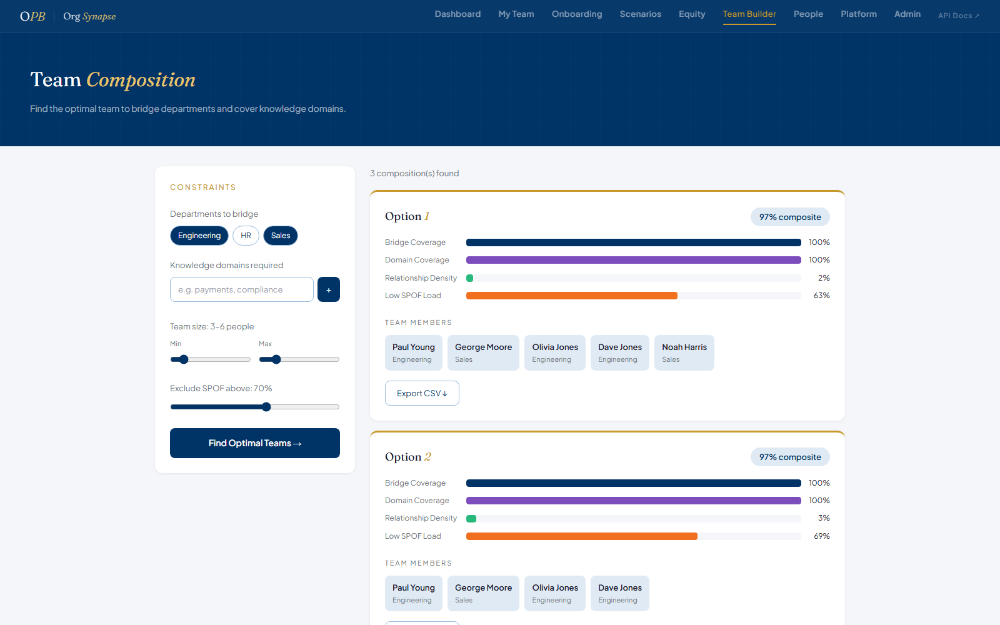
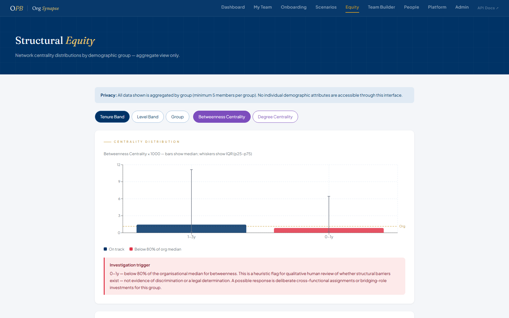

# Math Model — Organizational Synapse

A single reference for every quantity the platform computes, **written from the code as it runs today**. Each formula links to its implementation.

[MODEL.md](MODEL.md) is the companion research document. It holds the theoretical justification, the literature, and the v2/v3 change history. Several of its sections still read "unchanged from original" and point at a v1 that is no longer in the repo; this document fills those gaps from the source. Where the code and MODEL.md disagree, §12 lists the difference so it can be fixed rather than hidden.

---

## Contents

1. [Notation](#1-notation)
2. [Graph construction](#2-graph-construction)
3. [Node metrics](#3-node-metrics)
4. [Interaction entropy and trend](#4-interaction-entropy-and-trend)
5. [SPOF score](#5-spof-score)
6. [Knowledge risk and enhanced SPOF](#6-knowledge-risk-and-enhanced-spof)
7. [Silo detection](#7-silo-detection)
8. [Anomaly detection](#8-anomaly-detection-isolation-forest)
9. [Churn models](#9-churn-models)
10. [Prescriptive models](#10-prescriptive-models)
11. [Org health score](#11-org-health-score)
12. [Spec vs. implementation](#12-spec-vs-implementation)
13. [How the models are validated](#13-how-the-models-are-validated)

---

## 1. Notation

| Symbol | Meaning |
|---|---|
| G = (V, E) | Directed weighted collaboration graph over a rolling window W (default 30 days) |
| w(u,v) | Sum of event weights from u to v inside W |
| N(v) | Undirected neighbourhood: predecessors ∪ successors of v |
| dept(v) | Department attribute on node v |
| R(x, V) | Percent rank of x in population V: `#{y ∈ V : y < x} / (|V| − 1)` |
| clip(x, a, b) | min(max(x, a), b) |

---

## 2. Graph construction

**Code:** [`graph/builder.py`](../graph/builder.py)

```
Events e = (s, t, channel, direction, ts, weight)   with ts ∈ [T − W, T]
          and consent(s) ∧ consent(t) ∧ active(s) ∧ active(t)

w(s, t) = Σ_e weight(e)
```

- The graph is **directed**. A→B and B→A are separate edges, which keeps asymmetry (who initiates and who receives).
- The event `weight` defaults to 1.0 at ingestion, so in practice w(s,t) is an **interaction count**.
- The consent and active filters run **in SQL**, so excluded employees never become nodes.

> The channel × direction semantic multiplier ω(c, d) described in MODEL.md §2 (GitHub 3.0, Calendar 2.5, … `reviewed` 1.5 …) is **not applied** in the ingestion or graph path today. See §12.

---

## 3. Node metrics

**Code:** [`graph/metrics.py`](../graph/metrics.py)

| Metric | Definition | Implementation detail |
|---|---|---|
| **Betweenness** BC(v) | Σ_{s≠v≠t} σ(s,t\|v) / σ(s,t), normalized | Computed on the directed graph with path cost `1 / max(w, 1e-9)`, so frequent collaborators are "closer". Exact for n ≤ 500; above that, Brandes k-pivot sampling with k = 200 and `seed = 42` (error ≈ O(1/√k)) |
| **Degree** d_in, d_out | in/out degree ÷ (n − 1) | NetworkX degree centrality |
| **Clustering** CC(v) | Triangles through v ÷ possible triangles | On the **undirected** projection |
| **Community** | Louvain, max modularity | `random_state = 42`; for n > 500, up to 8 parallel trials and the best modularity wins |
| **Cross-department ratio** CDR(v) | `|{(v,u) ∈ E_out : dept(u) ≠ dept(v)}| / |E_out(v)|` | Counts out-edges (not weights); 0 if v has no out-edges |

---

## 4. Interaction entropy and trend

**Code:** [`ml/features/feature_extractor.py`](../ml/features/feature_extractor.py)

The window is split into 4 weekly buckets k = 0…3 (oldest first). For each employee and week:

```
p_k(v, u) = count_k(v → u) / Σ_x count_k(v → x)

H_k(v) = − Σ_u p_k(v,u) · log₂ p_k(v,u)        (bits; 0 if no activity)

entropy_trend(v) = slope of least-squares fit of H_0 … H_3 against k = 0…3
```

H measures how *spread* someone's collaboration is. A falling slope means the person is interacting with fewer distinct people, which is the **withdrawal** signal. It is the earliest-moving input in the system and also the noisiest one, which is why it carries the smallest weight in SPOF.

---

## 5. SPOF score

**Code:** [`graph/risk_scorer.py`](../graph/risk_scorer.py) · theory: [MODEL.md §5](MODEL.md#5-spof-score-formula)

### 5.1 Formula

Every component is converted to a percent rank over the population **before** weighting, so each weight controls its nominal share instead of letting the most skewed metric (betweenness) dominate:

```
SPOF(v) = clip(  α · R(BC(v))
               + β · R(CDR(v))
               + γ · R(1 − CC(v))
               − δ · R(entropy_trend(v)) ,  0, 1)

α, β, γ, δ = 0.4, 0.3, 0.2, 0.1        (SPOF_ALPHA … SPOF_DELTA)
```

The entropy term subtracts: the most-withdrawing employee has percentile 0 and loses nothing, while the most-engaging employee loses up to δ. The theoretical maximum is therefore α + β + γ = 0.9.

### 5.2 Robustness bands

The weight *ordering* is well-founded, but the magnitudes are not empirically calibrated. Every employee is therefore also scored under two perturbed weight sets. With ρ = `SPOF_PERTURB_RANGE` = 0.15:

```
hi:  α(1+ρ), β, γ(1−ρ), δ(1−ρ)   → renormalized to sum 1
lo:  α(1−ρ), β, γ(1+ρ), δ(1+ρ)   → renormalized to sum 1
```

| Flag | Rule | Action |
|---|---|---|
| `critical` | score ≥ 0.7 under central **and** lo **and** hi | Automatic `spof_critical` alert |
| `critical_uncertain` | ≥ 0.7 centrally but not under every perturbation | Human review, **no** automatic alert |
| `warning` | 0.5 – 0.7 | Cross-training |
| `elevated` | 0.4 – 0.5 | Watch entropy weekly |
| `normal` | < 0.4 | — |


---

## 6. Knowledge risk and enhanced SPOF

**Code:** [`graph/knowledge_risk.py`](../graph/knowledge_risk.py)

The inputs are document contribution counts c(v, d) per employee v and domain d, taken from Confluence and Notion.

```
sole(v, d)  ⇔  c(v,d) > 0  and  v is the only contributor to d

K(v) = min(1,  0.5 · |sole domains of v| / |domains of v|
             + 0.3 · docs(v) / max_u docs(u)
             + 0.2 · |domains of v| / |all domains| )

SPOF⁺(v) = (1 − δ_k) · SPOF(v) + δ_k · K(v),        δ_k = KNOWLEDGE_DELTA = 0.3
```

Per-domain expertise is `c(v,d) / max_u c(u,d)`, multiplied by 1.2 for a sole expert and capped at 1.

**Why it's separate:** a sole expert with no cross-department bridges is a knowledge risk, not a structural one. The validation suite (see §13) confirms that graph-only SPOF keeps sole experts below the critical line (max 0.63). K(v) is the signal that catches them.

---

## 7. Silo detection

**Code:** [`graph/silo_detector.py`](../graph/silo_detector.py)

Silos are evaluated per **department**, not per Louvain community. Department is the unit HR can act on, and Louvain can merge a siloed department into a hub's community.

```
internal(D)  = |{(u,v) ∈ E : u ∈ D, v ∈ D}|
outgoing(D)  = |{(u,v) ∈ E : u ∈ D, v ∉ D}|

isolation(D) = internal(D) / max(outgoing(D), 1)

silo      if isolation(D) > θ           θ = SILO_THRESHOLD = 2.5
critical  if isolation(D) > 2θ          else high
```

Only *outgoing* edges count, so a department isn't excused just because others reach into it.

---

## 8. Anomaly detection (Isolation Forest)

**Code:** [`ml/anomaly/isolation_forest.py`](../ml/anomaly/isolation_forest.py)

The feature vector (8 dimensions, z-scored with `StandardScaler`) is:

```
[ BC, d_in, d_out, CC, ΔBC_7d, Δd_out_7d, H_current, entropy_trend ]
```

`IsolationForest(n_estimators=100, contamination=0.05)`. The sklearn `decision_function` is min-max inverted onto [0, 1], so 1 = most anomalous:

```
a(v) = 1 − (s(v) − min s) / (max s − min s)
severity:  a > 0.9 critical · a > 0.75 high · else medium
```

The 7-day deltas matter most for **bridge collapse**, where current values look ordinary but betweenness has just dropped sharply.

---

## 9. Churn models

### 9.1 ChurnGAT (graph)

**Code:** [`ml/gnn/feature_builder.py`](../ml/gnn/feature_builder.py), [`ml/gnn/model.py`](../ml/gnn/model.py) · card: [MODEL_CARD_CHURN.md](MODEL_CARD_CHURN.md)

There are 11 node features:

| # | Feature | Scaling |
|---|---|---|
| 0 | tenure | days / 3650, cap 1 |
| 1 | role level | level / 7 |
| 2 | PTO used | days / 90, cap 1 |
| 3–6 | BC, d_in, d_out, CC | as §3 |
| 7–8 | ΔBC_7d, Δd_out_7d | as §8 |
| 9 | H_current | cap 1 |
| 10 | entropy_trend | clip [−1, 1] |

Edge weight is `log1p(count)`. The architecture is:

```
GATConv(11 → 64 × 4 heads) → ELU → dropout 0.3
GATConv(256 → 64, 1 head)  → ELU
Linear(64 → 32) → ReLU → dropout → Linear(32 → 1) → σ        loss: BCEWithLogits
```

Two attention layers cover the 1-hop signal. Deeper stacks over-smooth a graph with diameter around 4.

### 9.2 Peer contagion (rule layer)

**Code:** [`etl/tasks/compute_peer_contagion.py`](../etl/tasks/compute_peer_contagion.py)

```
peer_churn_rate(v) = |N(v) ∩ departed(T − 180d, T)| / max(|N(v)|, 1)

peer_contagion_risk  if  peer_churn_rate(v) > 0.30
```

This sits on top of the GAT rather than inside it, so existing checkpoints stay valid ([MODEL.md §7.4.1](MODEL.md#741-turnover-contagion--a-missing-feature)).

### 9.3 Temporal GNN

**Code:** [`graph/temporal/model.py`](../graph/temporal/model.py)

A `GConvGRU` (Chebyshev K = 1, hidden 32) reads T − 1 weekly snapshots and predicts the features of week T. The anomaly signal is the masked MSE reconstruction error:

```
H_t = GConvGRU(X_t, A_t, H_{t−1}),   X̂_T = Linear(H_{T−1}),   err(v) = ‖X̂_T(v) − X_T(v)‖²
```

---

## 10. Prescriptive models

### 10.1 Succession compatibility

**Code:** [`graph/succession.py`](../graph/succession.py) · [MODEL.md §8](MODEL.md#8-succession-compatibility-score)

The candidates are **border employees**: people outside the source's Louvain community who have at least one edge into it.

```
w̃(v,u) = w(v,u) / Σ_x w(v,x)                     (share of v's interaction budget)

J̃(s,c) = Σ_{u ∈ N(s) ∩ N(c)} min(w̃(s,u), w̃(c,u)) / Σ_{u ∈ N(s) ∪ N(c)} max(w̃(s,u), w̃(c,u))

compat(s,c) = 0.40 · J̃(s,c) + 0.25 · CC(c) + 0.35 · |dom(s) ∩ dom(c)| / max(|dom(s)|, 1)
```

Using proportional weights removes the tenure bias: raw weights grow with time at the company, not with structural fit.

### 10.2 Onboarding integration

**Code:** [`etl/tasks/compute_onboarding.py`](../etl/tasks/compute_onboarding.py)

This applies to hires within the last 180 days, compared against a cohort in the same 30-day tenure band:

```
OIS(v) = 0.5 · min(degree(v) / median_cohort_degree, 1)
       + 0.3 · min(cross_dept_edges_30d(v) / 5, 1)
       + 0.2 · CS_overlap(v)

CS_overlap(v) = |Com_t(v) ∩ Com_{t−7}(v)| / |Com_t(v) ∪ Com_{t−7}(v)|     (stable if ≥ 0.6)

alert  if  degree(v) ≤ p25_cohort  and  tenure(v) ≥ 60 days
```

CS_overlap compares *membership sets*, not Louvain IDs, because IDs are arbitrary from one run to the next.

### 10.3 Team composition

**Code:** [`graph/team_optimizer.py`](../graph/team_optimizer.py)

```
score(T) = 0.40 · bridge_coverage(T) + 0.35 · domain_coverage(T) + 0.25 · (1 − load(T))

bridge_coverage = fraction of requested dept pairs (d1,d2) with a member in d1 adjacent to d2 (or vice versa)
load(T)         = Σ_{v ∈ T} SPOF(v) / max possible load
```

Search is **greedy set-cover**. The coverage objective is submodular, so greedy is within (1 − 1/e) of optimal (Nemhauser et al., 1978). Members above the SPOF exclusion threshold (UI default 0.70) are skipped so already-overloaded people aren't piled on.



### 10.4 Reorg scenario impact

**Code:** [`graph/scenario_simulator.py`](../graph/scenario_simulator.py)

Operations (`remove`, `merge_depts`, `move_team`) are applied to an in-memory copy of G. The simulator reports:

```
Δpath%       = (L_after − L_before) / L_before × 100      L = avg shortest path, largest WCC
new_isolated = WCC_after − WCC_before
ΔSPOF(v)     = SPOF_after(v) − SPOF_before(v)   for the most affected employees
```

The validation suite combines these into `damage = Δpath% + 20 · new_isolated`.


### 10.5 Structural equity

**Code:** [`etl/tasks/compute_equity.py`](../etl/tasks/compute_equity.py) · [MODEL.md §11](MODEL.md#11-structural-equity-analytics)

For dimension g ∈ {gender_group, tenure_band, level_band} and metric m ∈ {betweenness, degree, cross_dept_ratio}:

```
M(g, m) = median of m over consenting members of g        (only groups with ≥ k members; k = EQUITY_MIN_GROUP_SIZE = 5)

flag  if  M(g, m) < 0.8 · M(all, m)                        (EQUITY_DISPARITY_RATIO)
```

The 0.8 ratio borrows from the EEOC four-fifths rule **as an investigation trigger only**. Centrality is not a selection rate.

Groups smaller than k are suppressed twice: they are never persisted (`HAVING COUNT(*) >= k`) and never returned by the API. The API reports only how many groups were hidden, because a median over one to four people can reveal an individual's position.



---

## 11. Org health score

**Code:** [`graph/org_health.py`](../graph/org_health.py) · [MODEL.md §12](MODEL.md#12-org-health-score)

```
silo_risk    = min(active_silos / max(⌊departments / 3⌋, 2), 1)
spof_risk    = clip(mean_v SPOF(v), 0, 1)
entropy_risk = clip(− mean_v entropy_trend(v) / 0.05, 0, 1)
frag_risk    = 1 − exp(−1.5 · (WCC − 1))

composite = 0.20 · silo + 0.35 · spof + 0.20 · entropy + 0.25 · frag
health    = 100 · (1 − composite)
```

The tiers are: healthy ≥ 80 · caution 60–79 · at_risk 40–59 · critical < 40.

The fragmentation term is convex on purpose. The first split (WCC 1 → 2) costs ≈ 0.78 of its weight right away, because a disconnected component cannot be bridged without intervention.

---

## 12. Spec vs. implementation

Places where [MODEL.md](MODEL.md) and the running code currently differ. Each is a backlog item, not a hidden assumption.

| Area | MODEL.md says | Code does | Impact |
|---|---|---|---|
| Channel semantics | w += weight × ω(channel, direction), with `CHANNEL_WEIGHT_*` / `DIRECTION_WEIGHT_*` env vars | ω not applied; those env vars are read nowhere (only the synthetic generator uses channel *frequencies*) | A code review counts the same as a Slack @mention. SPOF still ranks archetypes correctly in validation, but tacit-knowledge links are under-weighted |
| Betweenness graph | Converted to undirected | Computed on the directed graph | Directed BC is stricter; bridges that only *receive* score lower |
| SPOF perturbation | lo = (0.35, 0.25, 0.25, 0.15), hi = (0.50, 0.30, 0.15, 0.05) | ±15 % on α, γ, δ around the central weights, β fixed, renormalized | Narrower bracket than documented, so fewer `critical_uncertain` flags |
| Knowledge blend env var | `KNOWLEDGE_LAMBDA` | `KNOWLEDGE_DELTA` | Setting the documented name has no effect |
| Org health `spof_risk` | mean SPOF over employees with SPOF > 0.3 | mean over **all** employees | Lower spof_risk, so a higher health score in orgs with a long tail of low-SPOF staff |
| Org health `entropy_risk` | fraction of employees with trend < −0.05 | −mean(trend) / 0.05, clipped | A few strongly withdrawing people can be averaged away |
| Onboarding alert | DCP < 0.25 and tenure ≥ 60 | degree ≤ cohort p25 and tenure ≥ 60 | Equivalent intent; cohort-relative rather than absolute |
| Silo threshold | `SILO_THRESHOLD` removed in v2 | Still read: 2.5 in `silo_detector`, 4.0 default in `scenario_simulator` | Scenario "silos before → after" uses a different threshold than the dashboard |

---

## 13. How the models are validated

`tests/validation/` builds synthetic organizations with **planted ground truth** (bridges, withdrawing employees, sole experts, silos) and checks that each model recovers them. There are 30 tests, they need no DB or Kafka, and they run in about 12 seconds. All 30 passed when these docs were written.

| Model | Key result | Gate |
|---|---|---|
| SPOF identification | Precision@critical 100 %, bridge recall 100 %, Spearman ρ 0.80 on archetype medians | ≥ 80 %, 100 %, ≥ 0.60 |
| SPOF vs. removal damage | ρ 0.90 (archetype medians), Precision@5 60 % | ≥ 0.80, ≥ 40 % |
| Churn | LogReg (3 feats) AUROC 0.722 vs GraphMLP 0.616 at N = 300 | both > 0.5; **baseline wins** |
| Isolation Forest | Severe recall 100 % (oracle), 75 % at production contamination | 100 %, ≥ 50 % |

The full tables are in the [README](../README.md#validation--results). What these results mean for decisions is in [LESSONS_LEARNED.md](LESSONS_LEARNED.md).

---

*OPB · Octavio Pérez Bravo · Data & AI Strategy Architect*
