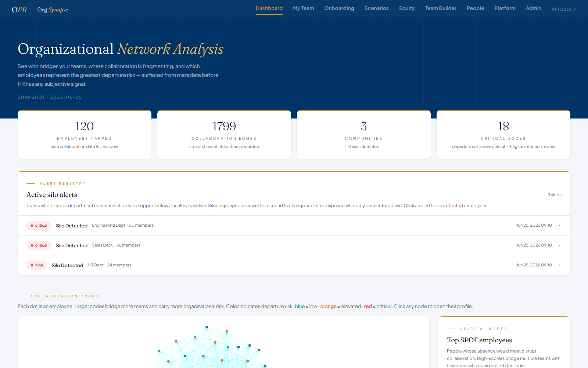
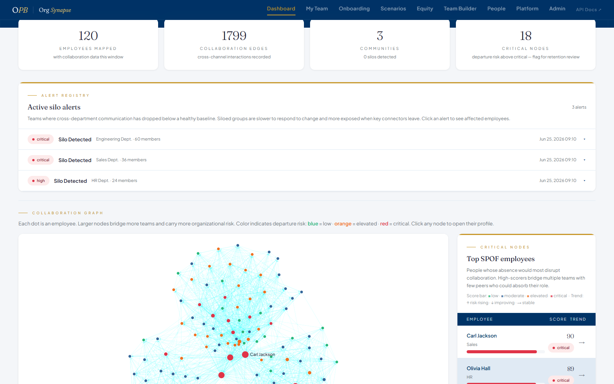
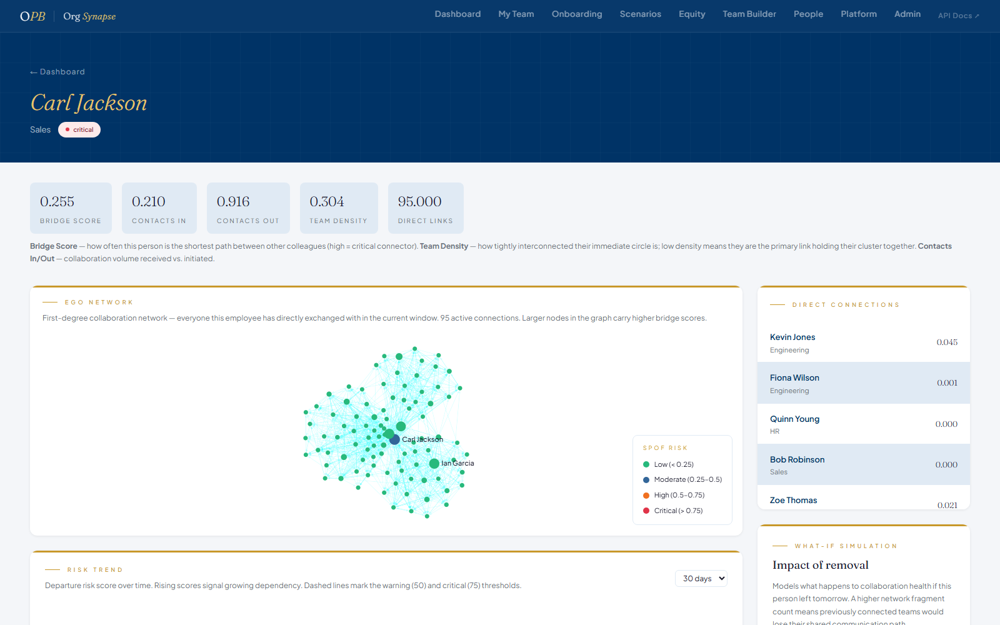
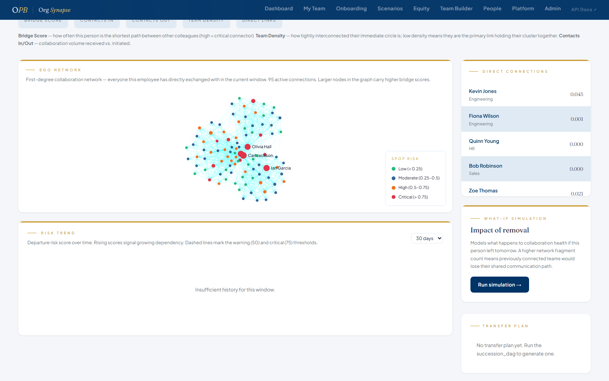
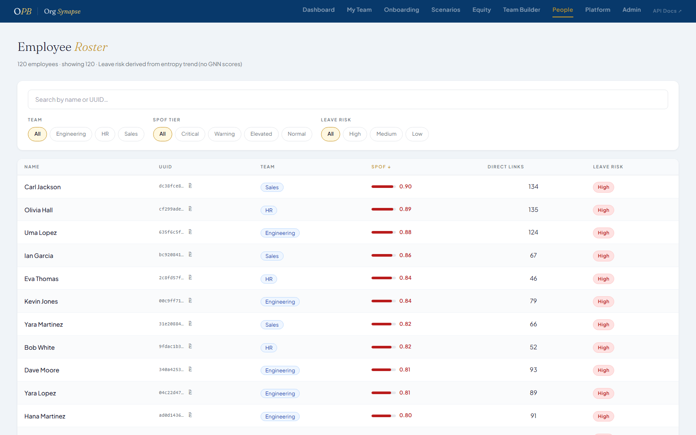
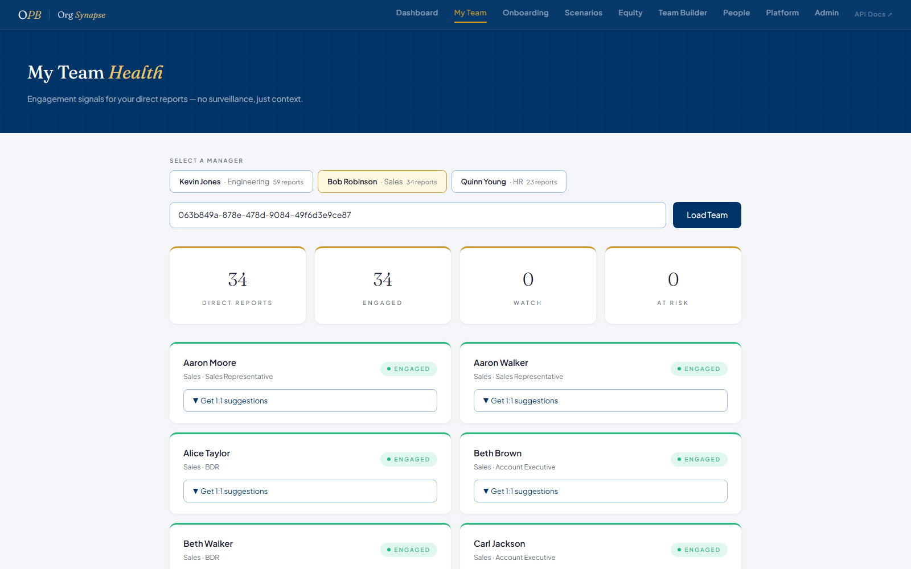
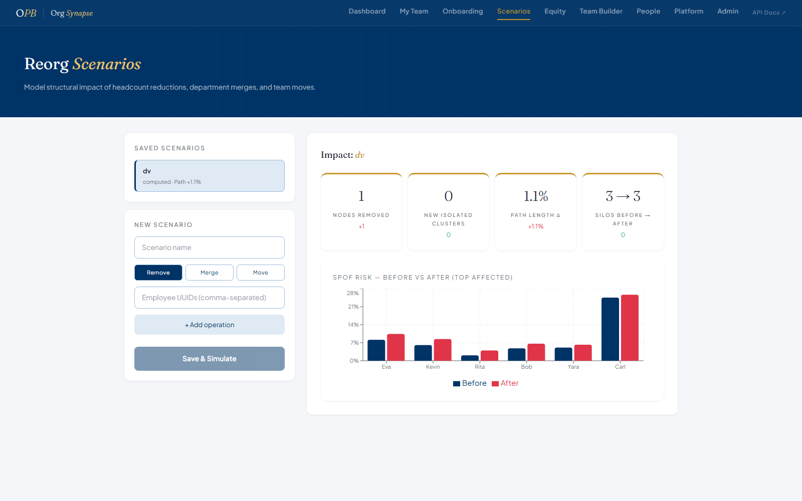
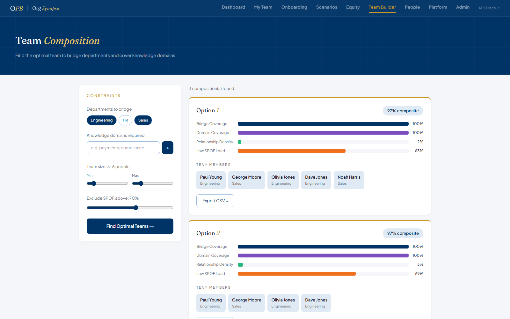
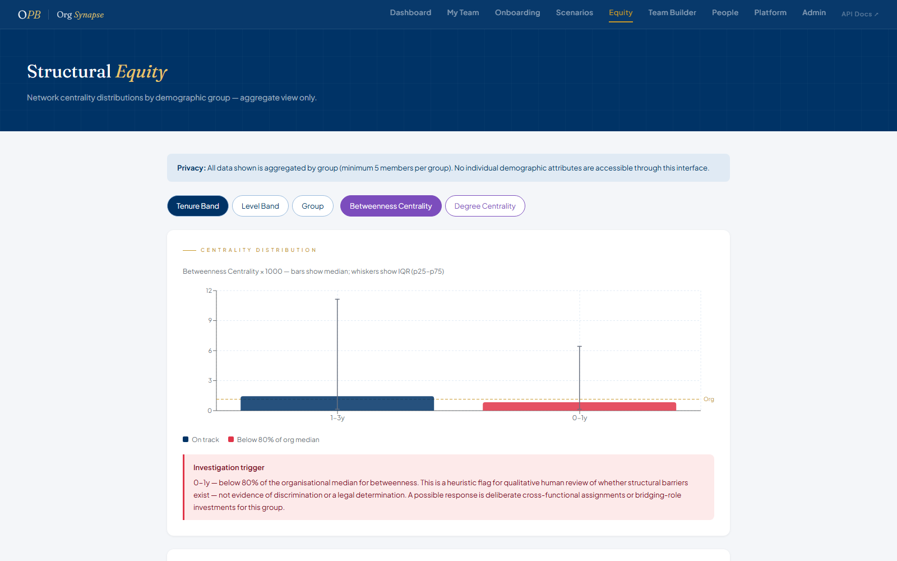
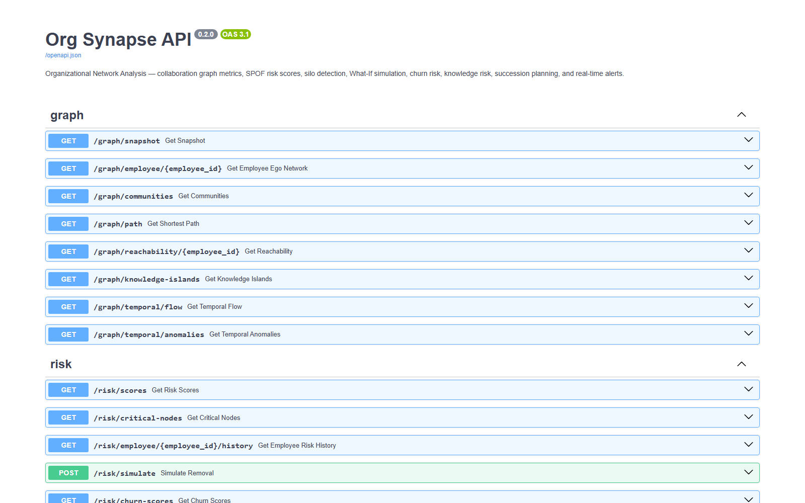

# Documentation — Organizational Synapse

| Document | Read it if you want to… |
|---|---|
| [ARCHITECTURE.md](ARCHITECTURE.md) | understand the components, data flow, storage, tenancy and privacy boundaries |
| [ENGINEERING.md](ENGINEERING.md) | work on the code: conventions, local setup, quality gates, how to add a score |
| [MATH_MODEL.md](MATH_MODEL.md) | see every formula exactly as implemented, plus where the spec and code differ |
| [BUSINESS_VALUE.md](BUSINESS_VALUE.md) | estimate and prove the value: levers, worked example, 90-day pilot, KPIs |
| [LESSONS_LEARNED.md](LESSONS_LEARNED.md) | learn what went wrong, what changed, and what's still open |
| [MCP.md](MCP.md) | connect an LLM client (Claude Code / Desktop, agents) to the API and the app |
| [MODEL.md](MODEL.md) | read the research foundation: theory, literature and the v2/v3 corrections |
| [Decisions.md](Decisions.md) | look up why each technology and design choice was made (ADR-style) |
| [Business.md](Business.md) | read the market, ICP, pricing, GTM and competitive landscape |
| [PITCH.md](PITCH.md) | have the buyer-facing narrative for HR leaders |
| [MODEL_CARD_CHURN.md](MODEL_CARD_CHURN.md) | check the ChurnGAT intended use, evaluation, limitations, fairness |
| [DPIA_THREAT_MODEL.md](DPIA_THREAT_MODEL.md) | review the GDPR Art. 35 DPIA and threat model |

---

## Screenshots

Captured from a live instance seeded with `scripts/seed_dev.py` (120 synthetic employees). Viewport 1600 × 1000.

| | |
|---|---|
| **Dashboard.** KPIs, silo alerts, collaboration graph  | **Collaboration graph.** Node size = bridging, color = SPOF risk  |
| **Employee detail.** SPOF components and ego network  | **Employee detail.** Risk trend, What-If, transfer plan  |
| **People roster.** Org-wide SPOF and leave risk  | **My Team.** Manager traffic-light view  |
| **Reorg scenarios.** Before/after structural impact  | **Team builder.** Greedy set-cover compositions  |
| **Structural equity.** Centrality by group  | **API.** FastAPI Swagger UI  |

To refresh them, start Postgres, the API and Vite (see [ENGINEERING §3.2](ENGINEERING.md#32-minimum-stack-for-frontend-work)), then capture each route at 1600 × 1000 with Playwright or any headless browser.
